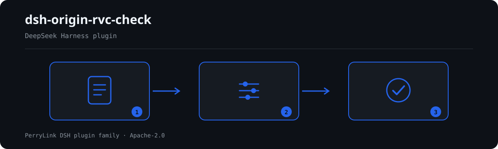

# dsh-origin-rvc-check — 原产地区域价值成分核对

[English](README.md) · [简体中文](README-zh.md) · [Español](README-es.md) · [Português](README-pt.md) · [हिन्दी](README-hi.md)

[](https://dsh.market/)

`dsh-origin-rvc-check` 读取一份原产地判定台账——表头写明协定与产品，每种料件一行——核对这份台账自身的算术：协定与产品是否声明、区域价值成分是否等于 (FOB − 非原产材料价值) ÷ FOB × 100、RVC 是否达到你配置的门槛、每条料件是否填写原产国、原产地标准是否出自你所适用协定的口径、料件序号是否唯一、品名栏是否残留未替换的占位符。

## Install

```sh
dsh plugin --profile <name> add dsh-origin-rvc-check
dsh --profile <name> --dump-config | grep 'dsh-origin-rvc-check'
```

## 实际输出长什么样



*工作流概览：文档 → 规则包 → 核对结果。下面的示例使用实际命令面。*


本插件对自己 `OR-001` 测试夹具的**真实输出**，不是示意图。规则库不伪造引文，因此每条发现都会同时写明所引条款，以及该条款原文本次未取得。

## 它回答什么问题

### 示例

下表是示例集：第一行是详细走查，其余行是简短案例。


| 你会问 | 它怎么答 |
|---|---|
| 「区域价值成分」栏填的是 `70.00`，但该行「净价值」是 `220`、表头 FOB 是 `400`，这种情况查得出来吗？ | 查得出来。`OR-002` 拿「净价值」栏与 FOB 按扣减法 (FOB − 非原产材料价值) ÷ FOB × 100 重算，容差 0.5 个百分点，填报值与之不符即逐行报出。它只做算术，而且按扣减法核对：台账若按累加法填写，即使口径本身正确也会被报出差异，此时请改 `expression` 或停用本条。RVC、净价值、FOB 有一项读不成数值时，本条报告「无法执行」，不会静默通过。 |
| 台账里没有任何地方设置门槛，结果每行都通过了——它到底核对了 RVC 没有？ | 没有。`OR-003` 的 `threshold` 出厂为 `0`，表示未配置，本条会报在 `skipped` 里，而不是静默通过。把它改成你所适用协定的门槛（例如 `40`），低于该值的行才会被报出。命中只表示「低于你配置的门槛」，**不表示**该货物不具备原产资格——原产资格还可以由完全获得、税则归类改变等标准取得，RVC 只是其中一条路径。 |
| 有一行料件的「原产国」栏是空的。 | `OR-004` 会报出「原产国」栏存在但为空的每一行。它只核对这一栏是否填写，不判断申报的原产国是否真实、是否会影响原产资格；台账里根本没有原产国这一栏时，本条报告「不适用」，而不是静默通过。 |
| 「原产地标准」栏填了一个不在我清单里的值。 | `OR-005` 拿它和规则库的 `values` 逐个比对。`values` 出厂为空——原产地标准的名称与缩写随协定变化，本插件不硬编码——此时本条报告「无法执行」；把 `values` 填成你所适用协定的口径（完全获得、CTC、RVC、特定加工工序等）后，不在册的值即被报出。它只核对所填值是否在册，不判断该批货物是否满足该标准。 |
| 同一个「料件序号」出现在两行上。 | `OR-006` 会报出重复的「料件序号」，比较时忽略空白字符。序号重复会让非原产材料价值被重复计入合计，进而使 RVC 算错——这是会直接导致错误结论的那类缺陷。它只报出重复；两行中哪一行填错了，它不判断。 |
| 有一行的「品名」栏还写着 `【待填】`。 | `OR-007` 会报出品名中含规则库 `terms` 所列占位符的行——【、】、`{{`、`}}`、XXX、xxx、待填、待补充、TBD、todo、示例。照抄模板的台账看上去像已经盘点了实际料件，而 RVC 会算在一份并不存在的料件清单上。它只找列出的这些词，清单之外的占位符会漏过；`terms` 可按本机构模板调整。 |

## 依据的标准

本规则库不引用任何公开标准：核查未取得任何自由贸易协定原产地规则的逐字条文，因此每条规则的 `basis` 都如实写明这一点，`kind` 一律为 derived-from-principle、严重度封顶 `warn` 或 `info`。它依据的是台账自身的算术自洽，以及你按适用协定配置的 RVC 门槛与原产地标准口径。

| 文件 | 文号 | 引用它的规则 |
|---|---|---|
| 各自由贸易协定原产地规则（协定文本，本次未取得） | 现行协定版本本次未核实 | OR-001, OR-002, OR-003, OR-004, OR-005, OR-006, OR-007 |

**边界（中文译文，以英文原文为准）：** 本插件核对一份**原产地判定台账**的算术——是否声明协定与产品，区域价值成分是否等于（FOB − 非原产材料价值）÷ FOB × 100，RVC 是否达到你配置的门槛，每种材料是否写明其原产地，原产地标准是否取自你所适用协定的取值口径，材料编号是否唯一，以及是否残留占位符。它**不**判定货物是否具备原产资格、是否适用优惠税率、原产地声明是否有效，也不判定是否发生原产地规避。

> ### ⚠️ 原产地规则是条约文本，本规则库不假装引用其中任何一条（以英文原文为准）
>
> RVC 以及其他原产地标准——完全获得、税则归类改变——由**各自由贸易协定自己的原产地规则**设定。RCEP、中国—东盟、中国—韩国等协定在阈值上（40%、30% 及其他档次）和计算方法上都各不相同。**核验环节没有从任何协定中取得逐字原文**，因此每条规则的 `basis` 都如实写明这一点，并停留在 `warn` 或 `info`。
>
> 在信任一项发现之前，有三点后果值得了解：
>
> - **`OR-002` 假定的是扣减法**——RVC = (FOB − VNM) ÷ FOB × 100。有些协定允许**累加法**（区域价值 ÷ FOB × 100），对同样的货物会得出不同的数值。按那种方法计算的台账会被报出差异；请修改 `expression` 或停用该规则。该项检查通过表头回退来读取 FOB 和净价值，因此整套数据只声明一次的数值也能被找到。
> - **`OR-003` 的阈值出厂时未设定。** 阈值因协定*和*税则行而异，因此本插件不硬编码任何阈值。一项发现的意思是「低于你设定的阈值」，**而不是**「这些货物非原产」——因为原产地也可以通过完全获得或税则归类改变标准取得。**RVC 只是其中一条路径。** 这一区分很重要，该规则的说明也写明了它。
> - **`OR-005` 的标准词表出厂为空**；标准名称和缩写因协定而异。

## Compatibility

| 项目 | 状态 |
|---|---|
| Harness | 对等版本范围 `>=0.1.2-rc.1 <0.2.0 \|\| >=0.2.0-0 <0.3.0` —— 已实测同时接受 `0.2.0-rc.2` 与 `0.2.1-rc.2`。**已声明 `engines.dsh`**：0.2.1 起由宿主单独裁决，范围为 `>=0.2.1-0 <0.3.0` |
| Node | `^22.19.0 || >=24.0.0` |
| 平台 | 全平台（纯 ESM；无原生代码、无联网、不调用模型） |
| 工具模式 | `native` / `ptc` 均可；批量校验整个目录时建议 `ptc`，schema 成本只付一次 |

## What it does

规则表、字段说明与行为细节见 [README.md](README.md#what-it-does)（英文主版本）。本插件只列出材料与所引条款之间的字面差异，并对无法执行的检查在 `skipped` 中逐项说明。

## Configuration

全部可调参数都在 `src/config.ts` 的 Schemastery schema 中，只改 `cordis.yml` 即可生效，无需改代码；逐条阈值在 `rules/` 下的规则库文件里。

| 键 | 类型 | 默认值 | 说明 |
|---|---|---|---|
| `rulesFile` | string | `rules/origin-rvc-check.yaml` | 规则库文件路径，相对插件包根目录 |
| `disabledRules` | string[] | `[]` | 要停用的规则 id 列表；每条都会出现在 `skipped` 中 |
| `onlyRules` | string[] | `[]` | 只执行这些规则 id；留空表示执行全部规则 |
| `skipNotes` | string | `""` | 附加到每条 `skipped` 说明后的备注 |
| `timeoutMs` | number | `120000` | 工具协作式超时预算（毫秒） |

## Material format

支持 JSON 与 YAML。完整字段示例见 [README.md](README.md#material-format)（英文主版本）。字段在读取层是可选的，由检查引擎校验，因此部分导出的材料会产生"缺项"类差异，而不是让程序崩溃。

## Rule sources

规则数据与代码分离，每条规则都带文件名、文号、按原文自身编号体系的条款号、逐字摘录与来源地址。加载期强制：摘录必须是真实引文且不少于八个字符；依据仅为原则性条款（`kind: derived-from-principle`，严重级上限 `warn`）或本机构配置（`kind: institutional-configuration`，上限 `info`）的检查不得标为 `error`。夸大依据的规则库会在加载期失败，而不会产出一份看起来很有底气的报告。

核验中确认的边界与"刻意没有作出的结论"见 [README.md](README.md#rule-sources)（英文主版本）与随包的 `rules/evidence/` 目录。

## Troubleshooting

- **插件装上了但工具不出现**：确认 `main` 指向 `lib/index.mjs` 且 `pnpm run build` 已生成该文件；`main` 写错会让加载器静默跳过该条目。
- **`dsh plugin add` 报版本不兼容**：peer 范围覆盖 `0.1.x` 与 `0.2.x`；若运行时在其之外，可显式豁免：`dsh plugin --profile <name> allow-version <包名@版本> --dsh-version <runtime> --accept-risk`
- **某条规则没有执行**：查看 `skipped` 数组，其中写明了规则 id 与原因。
- **`check` 报 `manifest-peers` 失败**：静态检查器比对的是一份早于 0.2 世代的硬编码 peer 范围；安装期的 peer 校验以运行时为准。这是 `dsh-plugin-dev` 的已知上游问题。
- **时间看起来偏移**：全部计算都是对输入字符串做墙上时钟运算，不做时区换算。

## Development

```sh
pnpm install
pnpm run typecheck
pnpm test
pnpm run build
node ../scripts/sync-shared.mjs dsh-origin-rvc-check
```

第 4 项把 `../_shared` 的共享件同步进 `src/shared/`；每次改动共享件后都要重跑。

## PerryLink DSH Plugin Family

本项目是 [PerryLink](https://github.com/PerryLink) 维护的 DeepSeek Harness 插件家族成员。完整名单默认折叠，避免每个 README 的首屏被长表淹没；点击展开可查看每一行及其状态。

<details>
<summary>展开全部插件</summary>

| 插件 | 状态 |
|---|---|
| **[dsh-aqua-input-check](https://github.com/PerryLink/dsh-aqua-input-check)** |  |
| **[dsh-archive-check](https://github.com/PerryLink/dsh-archive-check)** |  |
| **[dsh-auto-review](https://github.com/PerryLink/dsh-auto-review)** |  |
| **[dsh-autotier](https://github.com/PerryLink/dsh-autotier)** |  |
| **[dsh-bid-ca-precheck](https://github.com/PerryLink/dsh-bid-ca-precheck)** |  |
| **[dsh-bid-qual-check](https://github.com/PerryLink/dsh-bid-qual-check)** |  |
| **[dsh-cert-mcp](https://github.com/PerryLink/dsh-cert-mcp)** |  |
| **[dsh-checkpoint-rewind](https://github.com/PerryLink/dsh-checkpoint-rewind)** |  |
| **[dsh-click](https://github.com/PerryLink/dsh-click)** |  |
| **[dsh-composer-history](https://github.com/PerryLink/dsh-composer-history)** |  |
| **[dsh-contract-stance](https://github.com/PerryLink/dsh-contract-stance)** |  |
| **[dsh-customs-doc-check](https://github.com/PerryLink/dsh-customs-doc-check)** |  |
| **[dsh-data-quality](https://github.com/PerryLink/dsh-data-quality)** |  |
| **[dsh-demurrage-ledger](https://github.com/PerryLink/dsh-demurrage-ledger)** |  |
| **[dsh-doublecheck](https://github.com/PerryLink/dsh-doublecheck)** |  |
| **[dsh-drill-script-check](https://github.com/PerryLink/dsh-drill-script-check)** |  |
| **[dsh-eia-guide-check](https://github.com/PerryLink/dsh-eia-guide-check)** |  |
| **[dsh-emergency-plan](https://github.com/PerryLink/dsh-emergency-plan)** |  |
| **[dsh-essay-rubric-check](https://github.com/PerryLink/dsh-essay-rubric-check)** |  |
| **[dsh-evidence-check](https://github.com/PerryLink/dsh-evidence-check)** |  |
| **[dsh-export-ctl-check](https://github.com/PerryLink/dsh-export-ctl-check)** |  |
| **[dsh-fast](https://github.com/PerryLink/dsh-fast)** |  |
| **[dsh-fmea-table-check](https://github.com/PerryLink/dsh-fmea-table-check)** |  |
| **[dsh-forecast-penalty](https://github.com/PerryLink/dsh-forecast-penalty)** |  |
| **[dsh-fund-research](https://github.com/PerryLink/dsh-fund-research)** |  |
| **[dsh-github](https://github.com/PerryLink/dsh-github)** |  |
| **[dsh-gongwen-flow-check](https://github.com/PerryLink/dsh-gongwen-flow-check)** |  |
| **[dsh-gongwen-word-check](https://github.com/PerryLink/dsh-gongwen-word-check)** |  |
| **[dsh-guard-plan-qc](https://github.com/PerryLink/dsh-guard-plan-qc)** |  |
| **[dsh-hazchem-check](https://github.com/PerryLink/dsh-hazchem-check)** |  |
| **[dsh-hazplan-check](https://github.com/PerryLink/dsh-hazplan-check)** |  |
| **[dsh-hidden-risk-map](https://github.com/PerryLink/dsh-hidden-risk-map)** |  |
| **[dsh-hs-classify](https://github.com/PerryLink/dsh-hs-classify)** |  |
| **[dsh-icd-rule-check](https://github.com/PerryLink/dsh-icd-rule-check)** |  |
| **[dsh-industry-research](https://github.com/PerryLink/dsh-industry-research)** |  |
| **[dsh-lawcite-adapter](https://github.com/PerryLink/dsh-lawcite-adapter)** |  |
| **[dsh-laya](https://github.com/PerryLink/dsh-laya)** |  |
| **[dsh-lc-doc-check](https://github.com/PerryLink/dsh-lc-doc-check)** |  |
| **[dsh-learning-gap-check](https://github.com/PerryLink/dsh-learning-gap-check)** |  |
| **[dsh-library](https://github.com/PerryLink/dsh-library)** |  |
| **[dsh-local-ai](https://github.com/PerryLink/dsh-local-ai)** |  |
| **[dsh-lsp-actions](https://github.com/PerryLink/dsh-lsp-actions)** |  |
| **[dsh-mask](https://github.com/PerryLink/dsh-mask)** |  |
| **[dsh-mcp-panel](https://github.com/PerryLink/dsh-mcp-panel)** |  |
| **[dsh-medrec-qc](https://github.com/PerryLink/dsh-medrec-qc)** |  |
| **[dsh-memento](https://github.com/PerryLink/dsh-memento)** |  |
| **[dsh-nsfc-form-check](https://github.com/PerryLink/dsh-nsfc-form-check)** |  |
| **[dsh-nurse-record-check](https://github.com/PerryLink/dsh-nurse-record-check)** |  |
| **[dsh-observe](https://github.com/PerryLink/dsh-observe)** |  |
| **[dsh-origin-rvc-check](https://github.com/PerryLink/dsh-origin-rvc-check)** |  |
| **[dsh-ota-review-check](https://github.com/PerryLink/dsh-ota-review-check)** |  |
| **[dsh-output-styles](https://github.com/PerryLink/dsh-output-styles)** |  |
| **[dsh-paper-doc-adapter](https://github.com/PerryLink/dsh-paper-doc-adapter)** |  |
| **[dsh-permission-rules](https://github.com/PerryLink/dsh-permission-rules)** |  |
| **[dsh-permit-report-check](https://github.com/PerryLink/dsh-permit-report-check)** |  |
| **[dsh-pipeline-check](https://github.com/PerryLink/dsh-pipeline-check)** |  |
| **[dsh-pleading-draft](https://github.com/PerryLink/dsh-pleading-draft)** |  |
| **[dsh-plugin-doctor](https://github.com/PerryLink/dsh-plugin-doctor)** |  |
| **[dsh-plugin-guide](https://github.com/PerryLink/dsh-plugin-guide)** |  |
| **[dsh-plugin-kit](https://github.com/PerryLink/dsh-plugin-kit)** |  |
| **[dsh-plugin-upgrade](https://github.com/PerryLink/dsh-plugin-upgrade)** |  |
| **[dsh-policy-brief-draft](https://github.com/PerryLink/dsh-policy-brief-draft)** |  |
| **[dsh-power-loss-split](https://github.com/PerryLink/dsh-power-loss-split)** |  |
| **[dsh-power-ticket-check](https://github.com/PerryLink/dsh-power-ticket-check)** |  |
| **[dsh-ppap-check](https://github.com/PerryLink/dsh-ppap-check)** |  |
| **[dsh-protest-deadline](https://github.com/PerryLink/dsh-protest-deadline)** |  |
| **[dsh-railway-window](https://github.com/PerryLink/dsh-railway-window)** |  |
| **[dsh-repair-order-qc](https://github.com/PerryLink/dsh-repair-order-qc)** |  |
| **[dsh-research-report](https://github.com/PerryLink/dsh-research-report)** |  |
| **[dsh-review-reply-check](https://github.com/PerryLink/dsh-review-reply-check)** |  |
| **[dsh-rulefile-check](https://github.com/PerryLink/dsh-rulefile-check)** |  |
| **[dsh-safety-brief-check](https://github.com/PerryLink/dsh-safety-brief-check)** |  |
| **[dsh-score](https://github.com/PerryLink/dsh-score)** |  |
| **[dsh-session-sync](https://github.com/PerryLink/dsh-session-sync)** |  |
| **[dsh-site-log-check](https://github.com/PerryLink/dsh-site-log-check)** |  |
| **[dsh-skill-pack-security](https://github.com/PerryLink/dsh-skill-pack-security)** |  |
| **[dsh-soe-decision-check](https://github.com/PerryLink/dsh-soe-decision-check)** |  |
| **[dsh-soilwater-check](https://github.com/PerryLink/dsh-soilwater-check)** |  |
| **[dsh-sop-sync-check](https://github.com/PerryLink/dsh-sop-sync-check)** |  |
| **[dsh-spc-gbt-adapter](https://github.com/PerryLink/dsh-spc-gbt-adapter)** |  |
| **[dsh-talk](https://github.com/PerryLink/dsh-talk)** |  |
| **[dsh-tender-extract](https://github.com/PerryLink/dsh-tender-extract)** |  |
| **[dsh-tender-matrix](https://github.com/PerryLink/dsh-tender-matrix)** |  |
| **[dsh-test-drive](https://github.com/PerryLink/dsh-test-drive)** |  |
| **[dsh-ticktick](https://github.com/PerryLink/dsh-ticktick)** |  |
| **[dsh-translate](https://github.com/PerryLink/dsh-translate)** |  |
| **[dsh-warranty-calc](https://github.com/PerryLink/dsh-warranty-calc)** |  |
| **[dsh-budget](https://github.com/PerryLink/dsh-budget)** | 🧊 已冻结 — 见仓库 README |
| **[dsh-claude-move](https://github.com/PerryLink/dsh-claude-move)** | 🧊 已冻结 — 见仓库 README |
| **[dsh-defend](https://github.com/PerryLink/dsh-defend)** | 🧊 已冻结 — 见仓库 README |
| **[dsh-draw](https://github.com/PerryLink/dsh-draw)** | 🧊 已冻结 — 见仓库 README |
| **[dsh-reach](https://github.com/PerryLink/dsh-reach)** | 🧊 已冻结 — 见仓库 README |
| **[dsh-background-agents](https://github.com/PerryLink/dsh-background-agents)** | 🚫 已退役 — 见仓库 README |
| **[dsh-session-pin](https://github.com/PerryLink/dsh-session-pin)** | 🚫 已退役 — 见仓库 README |
| **[dsh-team-rooms](https://github.com/PerryLink/dsh-team-rooms)** | 🚫 已退役 — 见仓库 README |

</details>

## License

[Apache License 2.0](LICENSE) © 2026 dsh-origin-rvc-check contributors.
