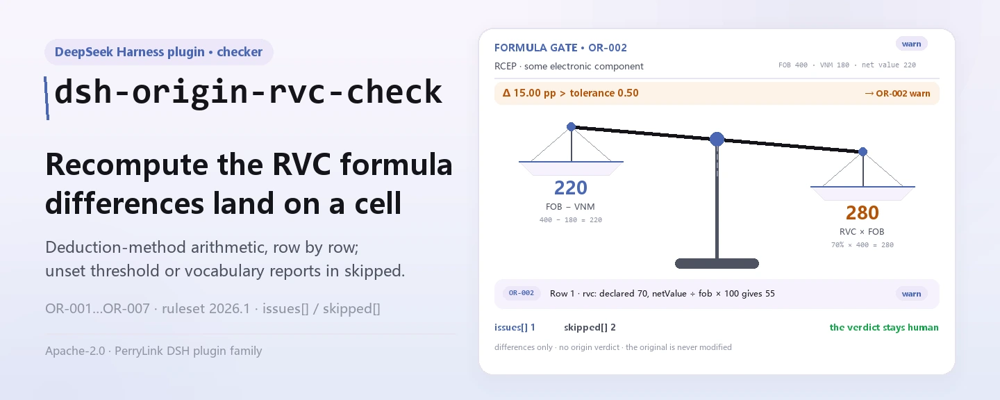

<div align="center">

<picture>
  <source media="(prefers-color-scheme: dark)" srcset="docs/assets/dsh-origin-rvc-check-hero-en-dark.webp">
  
</picture>

# dsh-origin-rvc-check

**Check an origin determination register line by line — RVC arithmetic and declaration fields — and get back a list of what is inconsistent, where, and what to fix.**

A DeepSeek Harness checker for origin-certificate and customs staff: the rule pack never fabricates a citation, it reports only the differences the register itself can mechanically decide, it makes no compliance verdict and assigns no liability, and it never modifies the original.

[Install](#three-step-setup) · [Configuration](#configuration) · [FAQ](#faq) · [简体中文](README.md) · [English](README.en.md) · [Español](README.es.md) · [Português](README.pt.md) · [हिन्दी](README.hi.md)

[](LICENSE)
[](#compatibility)
[](https://www.npmjs.com/package/dsh-origin-rvc-check)
[](https://github.com/PerryLink/dsh-origin-rvc-check/actions/workflows/ci.yml)
[](#compatibility)

[](https://github.com/PerryLink/dsh-origin-rvc-check/stargazers)
[](https://www.npmjs.com/package/dsh-origin-rvc-check)
[](https://dshfind.com/plugins/PerryLink/dsh-origin-rvc-check?ref=badge)
[](https://securityscorecards.dev/viewer/?uri=github.com/PerryLink/dsh-origin-rvc-check)
[](https://dsh.market/)
[](https://gitee.com/perrylink/dsh-origin-rvc-check)

```sh
dsh plugin --profile <name> add dsh-origin-rvc-check
```

</div>

<sub>Community plugin, not affiliated with DeepSeek. Canonical repository: <https://github.com/PerryLink/dsh-origin-rvc-check> (Gitee is a mirror).</sub>

## What it is

`dsh-origin-rvc-check` reads one origin determination register — the agreement header plus one row per material — and checks that register's own arithmetic: that the agreement and product are declared, that regional value content equals (FOB − non-originating value) ÷ FOB × 100, that RVC meets the threshold you configure, that every material states its origin, that the origin criterion comes from your agreement's vocabulary, that material numbers are unique, and that no unreplaced placeholder survives in the description. You hand over the source material (a table, register or document; Excel can be converted to JSON/YAML first, in chat if the platform supports it), and it returns a list of what is inconsistent, where, and what to fix. It makes no compliance verdict and assigns no liability, replaces no reviewer, and never modifies the original.

<picture>
  <source media="(prefers-color-scheme: dark)" srcset="docs/assets/dsh-origin-rvc-check-flow-v5-dark.svg">
  
</picture>

## Three-step setup

1. **Install**:

   ```sh
   dsh plugin --profile <name> add dsh-origin-rvc-check
   ```

   It is also listed as part of the "Customs Compliance Suite" pack in WorkBuddy / Coze (this check is one part of it; availability as listed).

2. **Minimal config** (sane defaults):

   ```yaml
   - insert:
       - id: dsh-origin-rvc-check
         name: dsh-origin-rvc-check
   ```

   Every tunable lives in the Schemastery schema of `src/config.ts`; the defaults work out of the box. Per-rule thresholds live in the rule pack under `rules/`.

3. **Verify it mounts**:

   ```sh
   dsh --profile <name> --dump-config | grep 'dsh-origin-rvc-check'
   ```

   Then run the bundled sample once (about 1 minute):

   ```sh
   node samples/quickstart/run.mjs --check
   ```

   The sample input is in `samples/quickstart/input/`, the expected output in `samples/quickstart/expected/result.json`, and the run screenshot in `docs/assets/quickstart.png`.

**Uninstall**: `dsh plugin --profile <name> remove dsh-origin-rvc-check` (or remove the row from the profile patch).

<details>
<summary>Install from the DSH Desktop market</summary>

Every PerryLink plugin is listed in the built-in DSH Desktop market: **Market → Sources → Add source → paste** `https://perrylink-dsh-catalog.perrylink.workers.dev/catalog-source.json` **→ select**. Installation still requires the market's npm identity check and your confirmation.

</details>

## Core capabilities

The plugin registers the `origin_rvc_check` tool: it reads one origin register (agreement header plus one row per material), applies a versioned rule pack, and returns a structured report.

- **The rule pack is data** — all seven checks live in `rules/origin-rvc-check.yaml`, so swapping rules needs no code change; the pack is validated on load, not trusted.
- **The register's own arithmetic only** — RVC is recomputed from the build-down definition and compared row by row with the declared figure; the plugin does not decide whether that RVC is enough to earn origin, nor whether the calculation convention is correct.
- **Severity follows the evidence** — a rule resting on a principle-derived clause (`derived-from-principle`) is capped at `warn`; an institution-configured threshold (`institutional-configuration`) is capped at `info`; neither may ever be marked `error` (a test asserts this).
- **An empty list is never "no problems"** — every check that could not run reports itself in `skipped` with its reason; a rule whose threshold or vocabulary is unset reports itself in `skipped` rather than passing silently.
- **No adjudicating** — the report only lists differences and never pronounces on compliance, liability or correctness; a wording guard forces the disclaimer onto every report.
- **Citations must be verbatim** — every rule carries document, number, clause, excerpt and source; when an excerpt under eight characters or the exact text could not be obtained, the excerpt says so and the rule is marked `derived-from-principle` — a paraphrase is never dressed up as a quotation.

```text
origin register (agreement · product · material rows) ──origin_rvc_check──▶ rule pack OR-001…OR-007 ──▶ report (findings + skipped)
        ▲                                                                                                        │
        └─────────────────────────────────────── the original is never modified ───────────────────────────────┘
```

### Rules at a glance

| Rule | Check | Severity | Basis kind |
|---|---|---|---|
| `OR-001` | the agreement and product are declared | warn | principle |
| `OR-002` | RVC follows the deduction formula | warn | principle |
| `OR-003` | RVC meets your configured threshold (off by default) | info | local |
| `OR-004` | every material states its origin | warn | principle |
| `OR-005` | the criterion comes from your vocabulary (off by default) | info | local |
| `OR-006` | material numbers are unique | warn | principle |
| `OR-007` | the description holds no unreplaced placeholder | warn | principle |

### Examples

These are the plugin's real entry points; install once, then call one.

**Detailed output** — tool `origin_rvc_check`, input:

```json
{"product":"某型电子元件","rows":[{"序号":"1","商品编号":"8541400000","品名":"某型电子元件","原产国":"日本","成交价格":"180","币制":"USD","非原产材料价值":"180","是否原产":"否","区域价值成分":"55.00","原产地标准":"RVC"}]}
```

Output:

```json
{
  "id": "dsh-origin-rvc-check.OR-001.811c9dc5",
  "ruleId": "OR-001",
  "severity": "warn",
  "locator": {
    "field": "agreement"
  },
  "found": "材料表头缺少 agreement",
  "expected": "表头应提供 agreement、product"
}
```

*Observed from `dsh-origin-rvc-check/tests/fixtures/OR-001/OR-001-unsafe.json`*

### What it answers

| You ask | What it answers |
|---|---|
| The RVC column says `70.00`, but the row's net value is `220` and the header's FOB is `400`. Is that caught? | Yes. `OR-002` recomputes the build-down formula (FOB − non-originating value) ÷ FOB × 100 from the net-value column and FOB, with a 0.5-point tolerance, and reports the row when the declared RVC differs. It does only the arithmetic, and it assumes the build-down method: a register filled in by the build-up method is reported although its own convention is right, so change `expression` or disable the rule. If the RVC, the net value or the FOB cannot be read as a number, the rule reports itself in `skipped` instead of passing silently. |
| No threshold is set anywhere, and every row passed. Did it check the RVC at all? | No. `OR-003` ships with `threshold: 0`, which means unconfigured, so the rule reports itself in `skipped` rather than passing silently. Set `threshold` to your agreement's figure (for example `40`) and it reports each row whose RVC falls below it. A finding means only “below the threshold you set” — not that the goods are not originating, because origin can also be earned through wholly-obtained or tariff-classification-change criteria; RVC is only one path. |
| One material row leaves the origin column blank. | `OR-004` reports every row whose origin column is present but empty. It checks only that the cell is filled, not whether the declared origin is true or whether it affects origin status; when the material carries no origin column at all, the rule reports that it does not apply instead of passing silently. |
| The origin-criterion column holds a value that is not in my list. | `OR-005` compares each value with the pack's `values` list. That list ships empty — criterion names and abbreviations differ per agreement, so the plugin hard-codes none — and the rule then reports itself in `skipped`; fill `values` with your agreement's criteria (for example wholly-obtained, CTC, RVC, specific-processing) and any value not on it is reported. It checks only that the value is on the list, not that the goods satisfy that criterion. |
| The same item number appears on two rows. | `OR-006` reports a repeated item number (itemNo), comparing the values with whitespace ignored. A duplicate double-counts the non-originating material value and therefore corrupts the RVC — this is the kind of defect that leads straight to a wrong conclusion. It reports the repetition; which of the two rows is wrong is not something it decides. |
| The description column still reads a template placeholder. | `OR-007` reports a row whose description contains any of the pack's `terms` — 【, 】, `{{`, `}}`, XXX, xxx, TBD, todo, and the Chinese to-fill / to-supplement / example words (the exact list is in `rules/origin-rvc-check.yaml`). A register copied from a template looks as if the materials had been counted, and the RVC then rests on a list of materials that does not exist. Only the listed terms are looked for, so a placeholder nobody listed passes; `terms` follows your own template. |

## Configuration

All tunables live in the Schemastery schema of `src/config.ts`, so they can be changed from `cordis.yml` without editing code; per-rule thresholds live in the rule pack under `rules/`.

| Key | Type | Default | Description |
|---|---|---|---|
| `rulesFile` | string | `rules/origin-rvc-check.yaml` | Rule-pack path, relative to the package root; replacing the file switches the rule-set version |
| `disabledRules` | string[] | `[]` | Rule ids to stop running; each appears in the report's `skipped` |
| `onlyRules` | string[] | `[]` | Run only these rule ids; empty runs every rule |
| `skipNotes` | string | `""` | Note appended to every `skipped` reason, e.g. a local implementation rule |
| `timeoutMs` | number | `120000` | Cooperative tool timeout budget (milliseconds) |

Rule-level parameters worth knowing:

- `OR-002` `expression` / `tolerance` — the RVC formula, `percent` over `[netValue, fob]` with a 0.5-point tolerance. Replace it with the build-up form if your agreement uses that method.
- `OR-003` `threshold` — your agreement's RVC threshold, e.g. `40`. `0` means the rule does not run.
- `OR-005` `values` — your agreement's criteria, e.g. `[wholly-obtained, CTC, RVC, specific-processing]`. Empty means no check.
- `OR-007` `terms` — the placeholders to look for.

## FAQ

<details>
<summary>Is the register uploaded or modified?</summary>

No. `dsh-origin-rvc-check` is a local-only checker: it reads the text you pass to its tool, uploads nothing, makes no network requests, and ships no telemetry, analytics or background reporting. It writes nothing outside the tool result and the DSH host's own session/log storage — the host controls that storage and its retention, and this package adds no second copy. The original document is never modified. This statement covers the npm package, not the DSH host or any other plugin in the profile (see `PRIVACY.md`).

</details>

<details>
<summary>With no threshold or vocabulary configured, does everything pass silently?</summary>

No. `OR-003`'s `threshold` and `OR-005`'s `values` both ship empty, and a rule that cannot run reports itself in `skipped` with its reason — an empty difference list is never read as "nothing is wrong". `OR-002` does the same when the RVC, net value or FOB cannot be read as a number. When the register is missing a column, the gap is usually reported as `skipped` or a missing-field finding rather than guessed at.

</details>

<details>
<summary>Why is every finding only `warn` or `info`?</summary>

By design: this checker makes no legal, customs or compliance determination — it lists differences and gaps for a human owner to act on. A rule resting on a principle-derived clause is capped at `warn`; an institution-configured threshold is capped at `info`; both are forbidden from `error` at load time (a test asserts this).

</details>

<details>
<summary>A finding says the clause text was not obtained — is that compliance evidence?</summary>

No. The rule pack follows a citation gate: it never invents clause text. When the exact text is unavailable, the finding stays at `warn`/`info` and says so in its `excerpt` (see "Standards it follows"). Treat that as a verification gap, not as proof that the document is compliant — nor as proof that the goods are at fault.

</details>

<details>
<summary>Can I run a whole year of registers or a whole directory?</summary>

Yes. The tool works in both `native` and `ptc`; for a whole directory use `ptc` so the schema cost is paid once. Everything runs locally — the time depends on the number of register rows, not on the network or a model call.

</details>

## Standards it follows

This rule pack cites no public standard: the verification pass obtained no verbatim text from any free trade agreement's rules of origin, so every rule's `basis` says so, each is `derived-from-principle` and none rises above `warn` or `info`. What the checks rest on instead is the register's own arithmetic, plus the RVC threshold and the criterion vocabulary you configure for the agreement that applies.

| Document | Number | Cited by rules |
|---|---|---|
| Rules of origin of the free trade agreements (agreement text, not obtained in this pass) | current agreement version, not verified in this pass | OR-001, OR-002, OR-003, OR-004, OR-005, OR-006, OR-007 |

**Boundary:** this plugin checks an **origin determination register** for arithmetic — that the agreement and product are
declared, that regional value content equals (FOB − non-originating value) ÷ FOB × 100, that RVC meets the
threshold you configure, that every material states its origin, that the origin criterion comes from your
agreement's vocabulary, that material numbers are unique, and that no placeholder survives. It does **not**
decide whether goods qualify as originating, whether a preferential rate applies, whether an origin declaration
is valid, or whether origin circumvention occurred.

> ### ⚠️ Origin rules are treaty text, and this pack does not pretend to quote one
>
> RVC and the other origin criteria — wholly obtained, change of tariff classification — are set by **each free
> trade agreement's rules of origin**. RCEP, ASEAN–China, China–Korea and the rest differ in their thresholds
> (40%, 30% and other tiers) and in their calculation methods. **The verification pass obtained no verbatim text
> from any agreement**, so every rule's `basis` says exactly that and stays at `warn` or `info`.
>
> Three consequences are worth knowing before trusting a finding:
>
> - **`OR-002` assumes the build-down method** — RVC = (FOB − VNM) ÷ FOB × 100. Some agreements permit the
>   **build-up** method (regional value ÷ FOB × 100), which yields a different number for the same goods. A
>   register computed that way will report a difference; change `expression` or disable the rule. The check
>   reads FOB and the net value through a header fallback, so a figure stated once for the whole set is found.
> - **`OR-003`'s threshold ships unset.** Thresholds vary by agreement *and* by tariff line, so the plugin
>   hard-codes none. A finding means "below the threshold you set", **not** "these goods are not originating" —
>   because origin can also be earned through wholly-obtained or tariff-classification-change criteria.
>   **RVC is only one path.** That distinction matters, and the rule's note states it.
> - **`OR-005`'s criterion vocabulary ships empty**; criterion names and abbreviations differ per agreement.

## Material format

The tool accepts JSON or YAML:

```yaml
agreement: RCEP
agreementVersion: 2022 年生效文本
exporter: 某某出口有限公司
product: 某型电子元件
fob: '400'
currency: USD
rows:
  - { 序号: '1', 商品编号: '8541400000', 品名: 某型电子元件, 原产国: 日本,
      非原产材料价值: '180', 净价值: '220', 区域价值成分: '55.00', 原产地标准: RVC }
```

Column names are matched case-insensitively and ignoring spaces, underscores and hyphens; the register's own
column names are kept, so a finding names the column it read. A figure stated once in the header — FOB, for
instance — is found by the arithmetic checks, so it need not be repeated on every row.

Fields are optional at the reader layer and validated by the check engine, so a partial export produces
missing-field findings instead of a crash.

## Rule sources

Rule data lives in `rules/origin-rvc-check.yaml`. Because origin rules are treaty text that the verification
pass could not obtain, the pack's `basis` entries say so explicitly instead of citing one. The load-time guard
still requires a document, clause, excerpt and source per rule, and still forbids a principle-derived or
locally configured check from being `error`.

The boundaries confirmed by the verification pass, and the conclusions it deliberately did **not** draw, are in
`rules/evidence/`.

## Compatibility

| Surface | Status |
|---|---|
| Harness | Peer range `>=0.1.2-rc.1 <0.2.0 \|\| >=0.2.0-0 <0.3.0` — verified to accept both `0.2.0-rc.2` and `0.2.1-rc.2`. `engines.dsh` is declared as `>=0.2.1-0 <0.3.0` and is enforced by the host since 0.2.1 |
| Node | `^22.19.0 \|\| >=24.0.0` |
| Platforms | All (plain ESM; no native code, no network, no model call) |
| Tool mode | Works in `native` and `ptc`; for a full directory use `ptc` |

## Troubleshooting

- **`OR-002` fires on every row.** The register was computed with the build-up method. Change `expression`, or disable the rule — do not widen the tolerance to hide a definition mismatch.
- **`OR-002` reports itself as skipped.** Either the net-value column is empty (the build-up method leaves it blank) or FOB is missing. The check will not guess which convention applies.
- **`OR-003` reports itself as skipped.** No threshold is set. Thresholds vary by agreement and tariff line, so the plugin hard-codes none.
- **`OR-003` fires although I believe the goods qualify.** RVC is only one path to origin. Wholly-obtained or tariff-classification-change criteria may still be met — confirm against the applicable agreement before concluding anything.
- **`OR-006` fires twice on one material.** Duplicate numbering double-counts the non-originating value and therefore corrupts the RVC. Correct the number.
- **The plugin installs but the tool never appears.** Check that `main` resolves to `lib/index.mjs` and that `pnpm run build` produced it; a wrong `main` makes the loader skip the entry silently.
- **`dsh plugin add` refuses the package as incompatible.** The peer range covers `0.1.x` and `0.2.x`; if your runtime sits outside it, grant an explicit exemption: `dsh plugin --profile <name> allow-version dsh-origin-rvc-check@0.1.0 --dsh-version <runtime> --accept-risk`
- **A rule did not run.** Read the `skipped` array — it names the rule id and the reason.
- **`check` reports `manifest-peers` as failed.** The static checker compares against a hard-coded peer range that predates the 0.2 line. The runtime enforces peer compatibility at install time, so the declared range is the correct one; this is a known upstream issue in `dsh-plugin-dev`.
- **Timestamps look shifted.** Every calculation is wall-clock arithmetic over the strings you supply; no time-zone conversion is applied.

## Ecosystem & quality

- [Gitee mirror](https://gitee.com/perrylink/dsh-origin-rvc-check) (sync mirror; GitHub is canonical)
- [dshfind plugin page](https://dshfind.com/plugins/PerryLink/dsh-origin-rvc-check) (installs and ranking)
- [OpenSSF Scorecard report](https://securityscorecards.dev/viewer/?uri=github.com/PerryLink/dsh-origin-rvc-check) (driven by [.github/workflows/scorecard.yml](.github/workflows/scorecard.yml))
- [DSH Market](https://dsh.market/) (listed)
- [Ecosystem knowledge base · choose a checker by material](https://perrylink.github.io/zh/checkers/choose/) (the full family: 62 checkers + general plugins)

## Development

```sh
pnpm install
pnpm run typecheck   # tsc --noEmit
pnpm test            # vitest, paired compliant/violating fixtures per rule (tests/fixtures/<RULE>/)
pnpm run build       # tsdown -> lib/index.mjs + lib/index.d.mts
pnpm run check:readmes   # five-language README consistency
node ../scripts/sync-shared.mjs dsh-origin-rvc-check   # refresh src/shared from ../_shared
```

The plugin is **data-driven**: `src/model.ts` declares the register shape, the shared kit supplies the reader and the check engine, and the rule pack declares every check. The last command copies the shared kit from `../_shared` into `src/shared/`; re-run it after every shared-kit change.

README images are generated programmatically by [`scripts/gen-readme-assets.py`](scripts/gen-readme-assets.py) (Python + Pillow) and are safe to re-run. This plugin has no UI, so the hero is a Pillow-drawn RVC balance (zh/en × light/dark, four files) and the structure figure is a hand-written SVG calculation workbench (light and dark versions).

Topics: `dsh`, `dsh-plugin`, `deepseek-harness`, `deepseek`, `cordis`, `origin`, `rvc`

## Family & thanks

This project is part of the DeepSeek Harness plugin family from [PerryLink](https://github.com/PerryLink) (all Apache-2.0). If it is useful, **a star helps the next person find it** — nothing is gated behind it.

- [@PerryLink](https://github.com/PerryLink) — creator and maintainer: the `origin_rvc_check` tool, the 7-rule pack and its clause-verification record, and the five-language docs.

<details>
<summary>Expand all plugins</summary>

| Plugin | Status |
|---|---|
| **[dsh-aqua-input-check](https://github.com/PerryLink/dsh-aqua-input-check)** |  |
| **[dsh-archive-check](https://github.com/PerryLink/dsh-archive-check)** |  |
| **[dsh-auto-review](https://github.com/PerryLink/dsh-auto-review)** |  |
| **[dsh-autotier](https://github.com/PerryLink/dsh-autotier)** | 🧊 FROZEN — see the repo README |
| **[dsh-bid-ca-precheck](https://github.com/PerryLink/dsh-bid-ca-precheck)** |  |
| **[dsh-bid-qual-check](https://github.com/PerryLink/dsh-bid-qual-check)** |  |
| **[dsh-cert-mcp](https://github.com/PerryLink/dsh-cert-mcp)** | 🧊 FROZEN — see the repo README |
| **[dsh-checkpoint-rewind](https://github.com/PerryLink/dsh-checkpoint-rewind)** |  |
| **[dsh-click](https://github.com/PerryLink/dsh-click)** |  |
| **[dsh-composer-history](https://github.com/PerryLink/dsh-composer-history)** |  |
| **[dsh-contract-stance](https://github.com/PerryLink/dsh-contract-stance)** |  |
| **[dsh-customs-doc-check](https://github.com/PerryLink/dsh-customs-doc-check)** |  |
| **[dsh-data-quality](https://github.com/PerryLink/dsh-data-quality)** | 🧊 FROZEN — see the repo README |
| **[dsh-demurrage-ledger](https://github.com/PerryLink/dsh-demurrage-ledger)** |  |
| **[dsh-doublecheck](https://github.com/PerryLink/dsh-doublecheck)** |  |
| **[dsh-drill-script-check](https://github.com/PerryLink/dsh-drill-script-check)** |  |
| **[dsh-eia-guide-check](https://github.com/PerryLink/dsh-eia-guide-check)** |  |
| **[dsh-emergency-plan](https://github.com/PerryLink/dsh-emergency-plan)** |  |
| **[dsh-essay-rubric-check](https://github.com/PerryLink/dsh-essay-rubric-check)** |  |
| **[dsh-evidence-check](https://github.com/PerryLink/dsh-evidence-check)** |  |
| **[dsh-export-ctl-check](https://github.com/PerryLink/dsh-export-ctl-check)** |  |
| **[dsh-fast](https://github.com/PerryLink/dsh-fast)** |  |
| **[dsh-fmea-table-check](https://github.com/PerryLink/dsh-fmea-table-check)** |  |
| **[dsh-forecast-penalty](https://github.com/PerryLink/dsh-forecast-penalty)** |  |
| **[dsh-fund-research](https://github.com/PerryLink/dsh-fund-research)** |  |
| **[dsh-github](https://github.com/PerryLink/dsh-github)** |  |
| **[dsh-gongwen-flow-check](https://github.com/PerryLink/dsh-gongwen-flow-check)** |  |
| **[dsh-gongwen-word-check](https://github.com/PerryLink/dsh-gongwen-word-check)** |  |
| **[dsh-guard-plan-qc](https://github.com/PerryLink/dsh-guard-plan-qc)** |  |
| **[dsh-hazchem-check](https://github.com/PerryLink/dsh-hazchem-check)** |  |
| **[dsh-hazplan-check](https://github.com/PerryLink/dsh-hazplan-check)** |  |
| **[dsh-hidden-risk-map](https://github.com/PerryLink/dsh-hidden-risk-map)** |  |
| **[dsh-hs-classify](https://github.com/PerryLink/dsh-hs-classify)** |  |
| **[dsh-icd-rule-check](https://github.com/PerryLink/dsh-icd-rule-check)** |  |
| **[dsh-industry-research](https://github.com/PerryLink/dsh-industry-research)** |  |
| **[dsh-lawcite-adapter](https://github.com/PerryLink/dsh-lawcite-adapter)** |  |
| **[dsh-laya](https://github.com/PerryLink/dsh-laya)** |  |
| **[dsh-lc-doc-check](https://github.com/PerryLink/dsh-lc-doc-check)** |  |
| **[dsh-learning-gap-check](https://github.com/PerryLink/dsh-learning-gap-check)** |  |
| **[dsh-library](https://github.com/PerryLink/dsh-library)** |  |
| **[dsh-local-ai](https://github.com/PerryLink/dsh-local-ai)** |  |
| **[dsh-lsp-actions](https://github.com/PerryLink/dsh-lsp-actions)** |  |
| **[dsh-mask](https://github.com/PerryLink/dsh-mask)** |  |
| **[dsh-mcp-panel](https://github.com/PerryLink/dsh-mcp-panel)** |  |
| **[dsh-medrec-qc](https://github.com/PerryLink/dsh-medrec-qc)** |  |
| **[dsh-memento](https://github.com/PerryLink/dsh-memento)** | 🧊 FROZEN — see the repo README |
| **[dsh-nsfc-form-check](https://github.com/PerryLink/dsh-nsfc-form-check)** |  |
| **[dsh-nurse-record-check](https://github.com/PerryLink/dsh-nurse-record-check)** |  |
| **[dsh-observe](https://github.com/PerryLink/dsh-observe)** |  |
| **[dsh-origin-rvc-check](https://github.com/PerryLink/dsh-origin-rvc-check)** |  |
| **[dsh-ota-review-check](https://github.com/PerryLink/dsh-ota-review-check)** |  |
| **[dsh-output-styles](https://github.com/PerryLink/dsh-output-styles)** |  |
| **[dsh-paper-doc-adapter](https://github.com/PerryLink/dsh-paper-doc-adapter)** |  |
| **[dsh-permission-rules](https://github.com/PerryLink/dsh-permission-rules)** |  |
| **[dsh-permit-report-check](https://github.com/PerryLink/dsh-permit-report-check)** |  |
| **[dsh-pipeline-check](https://github.com/PerryLink/dsh-pipeline-check)** |  |
| **[dsh-pleading-draft](https://github.com/PerryLink/dsh-pleading-draft)** |  |
| **[dsh-plugin-doctor](https://github.com/PerryLink/dsh-plugin-doctor)** | 🚫 RETIRED (repo archived) |
| **[dsh-plugin-guide](https://github.com/PerryLink/dsh-plugin-guide)** |  |
| **[dsh-plugin-kit](https://github.com/PerryLink/dsh-plugin-kit)** | 🚫 RETIRED (repo archived) |
| **[dsh-plugin-upgrade](https://github.com/PerryLink/dsh-plugin-upgrade)** | 🚫 RETIRED (repo archived) |
| **[dsh-policy-brief-draft](https://github.com/PerryLink/dsh-policy-brief-draft)** |  |
| **[dsh-power-loss-split](https://github.com/PerryLink/dsh-power-loss-split)** |  |
| **[dsh-power-ticket-check](https://github.com/PerryLink/dsh-power-ticket-check)** |  |
| **[dsh-ppap-check](https://github.com/PerryLink/dsh-ppap-check)** |  |
| **[dsh-protest-deadline](https://github.com/PerryLink/dsh-protest-deadline)** |  |
| **[dsh-railway-window](https://github.com/PerryLink/dsh-railway-window)** |  |
| **[dsh-repair-order-qc](https://github.com/PerryLink/dsh-repair-order-qc)** |  |
| **[dsh-research-report](https://github.com/PerryLink/dsh-research-report)** |  |
| **[dsh-review-reply-check](https://github.com/PerryLink/dsh-review-reply-check)** |  |
| **[dsh-rulefile-check](https://github.com/PerryLink/dsh-rulefile-check)** |  |
| **[dsh-safety-brief-check](https://github.com/PerryLink/dsh-safety-brief-check)** |  |
| **[dsh-score](https://github.com/PerryLink/dsh-score)** | 🧊 FROZEN — see the repo README |
| **[dsh-session-sync](https://github.com/PerryLink/dsh-session-sync)** |  |
| **[dsh-site-log-check](https://github.com/PerryLink/dsh-site-log-check)** |  |
| **[dsh-skill-pack-security](https://github.com/PerryLink/dsh-skill-pack-security)** |  |
| **[dsh-soe-decision-check](https://github.com/PerryLink/dsh-soe-decision-check)** |  |
| **[dsh-soilwater-check](https://github.com/PerryLink/dsh-soilwater-check)** |  |
| **[dsh-sop-sync-check](https://github.com/PerryLink/dsh-sop-sync-check)** |  |
| **[dsh-spc-gbt-adapter](https://github.com/PerryLink/dsh-spc-gbt-adapter)** |  |
| **[dsh-talk](https://github.com/PerryLink/dsh-talk)** |  |
| **[dsh-tender-extract](https://github.com/PerryLink/dsh-tender-extract)** |  |
| **[dsh-tender-matrix](https://github.com/PerryLink/dsh-tender-matrix)** |  |
| **[dsh-test-drive](https://github.com/PerryLink/dsh-test-drive)** |  |
| **[dsh-ticktick](https://github.com/PerryLink/dsh-ticktick)** | 🚫 RETIRED (repo archived) |
| **[dsh-translate](https://github.com/PerryLink/dsh-translate)** |  |
| **[dsh-warranty-calc](https://github.com/PerryLink/dsh-warranty-calc)** |  |
| **[dsh-budget](https://github.com/PerryLink/dsh-budget)** | 🧊 FROZEN — see the repo README |
| **[dsh-claude-move](https://github.com/PerryLink/dsh-claude-move)** | 🧊 FROZEN — see the repo README |
| **[dsh-defend](https://github.com/PerryLink/dsh-defend)** | 🧊 FROZEN — see the repo README |
| **[dsh-draw](https://github.com/PerryLink/dsh-draw)** | 🧊 FROZEN — see the repo README |
| **[dsh-reach](https://github.com/PerryLink/dsh-reach)** | 🧊 FROZEN — see the repo README |
| **[dsh-background-agents](https://github.com/PerryLink/dsh-background-agents)** | 🚫 RETIRED (repo archived) |
| **[dsh-session-pin](https://github.com/PerryLink/dsh-session-pin)** | 🚫 RETIRED (repo archived) |
| **[dsh-team-rooms](https://github.com/PerryLink/dsh-team-rooms)** | 🚫 RETIRED (repo archived) |

</details>

## License

[LICENSE](LICENSE) (Apache License 2.0) © 2026 dsh-origin-rvc-check contributors

<p align="center"><sub>Apache-2.0 · Community plugin, not affiliated with DeepSeek.</sub></p>
