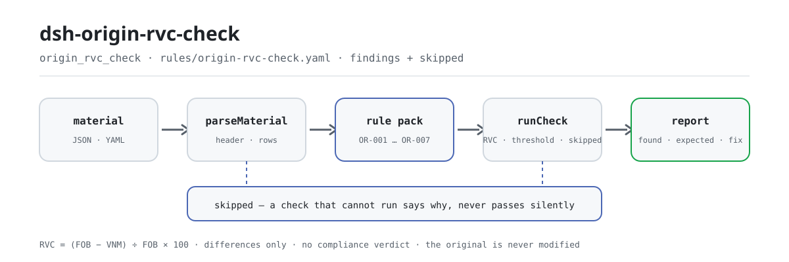

<div align="center">

<picture>
  <source media="(prefers-color-scheme: dark)" srcset="docs/assets/dsh-origin-rvc-check-flow-dark.svg">
  
</picture>

# dsh-origin-rvc-check

**Verifique línea por línea la aritmética del RVC y los campos declarados de un registro de determinación de origen — y reciba una lista de qué es inconsistente, dónde y qué corregir.**

Un verificador de DeepSeek Harness para personal de certificados de origen y aduanas: el paquete de reglas nunca inventa una cita, solo enumera las diferencias que el propio registro permite decidir mecánicamente, no emite juicio de cumplimiento ni atribuye responsabilidad, y nunca modifica el original.

[Instalar](#instalación-en-tres-pasos) · [Configuración](#configuración) · [FAQ](#faq) · [简体中文](README.md) · [English](README.en.md) · [Español](README.es.md) · [Português](README.pt.md) · [हिन्दी](README.hi.md)

[](LICENSE)
[](#compatibilidad)
[](https://www.npmjs.com/package/dsh-origin-rvc-check)
[](https://github.com/PerryLink/dsh-origin-rvc-check/actions/workflows/ci.yml)
[](#compatibilidad)

[](https://github.com/PerryLink/dsh-origin-rvc-check/stargazers)
[](https://www.npmjs.com/package/dsh-origin-rvc-check)
[](https://dshfind.com/plugins/PerryLink/dsh-origin-rvc-check?ref=badge)
[](https://securityscorecards.dev/viewer/?uri=github.com/PerryLink/dsh-origin-rvc-check)
[](https://dsh.market/)
[](https://gitee.com/perrylink/dsh-origin-rvc-check)

```sh
dsh plugin --profile <name> add dsh-origin-rvc-check
```

</div>

<sub>Plugin de la comunidad, no afiliado a DeepSeek. Repositorio canónico: <https://github.com/PerryLink/dsh-origin-rvc-check> (Gitee es un espejo).</sub>

## Qué es

`dsh-origin-rvc-check` lee un registro de determinación de origen (原产地判定台账) —la cabecera del acuerdo más una fila por material— y comprueba la aritmética de ese mismo registro: que se declaren el acuerdo y el producto, que el contenido de valor regional sea igual a (FOB − valor de los materiales no originarios) ÷ FOB × 100, que el RVC alcance el umbral que usted configura, que cada material indique su origen, que el criterio de origen proceda del vocabulario de su acuerdo, que los números de material no se repitan y que no quede ningún marcador de plantilla sin sustituir en la descripción. Usted entrega el material original (una tabla, un registro o un documento; Excel puede convertirse antes a JSON/YAML, incluso en el chat si la plataforma lo permite) y recibe una lista de qué es inconsistente, dónde y qué corregir. No emite juicio de cumplimiento ni atribuye responsabilidad, no sustituye al revisor y nunca modifica el original.

## Instalación en tres pasos

1. **Instale**:

   ```sh
   dsh plugin --profile <name> add dsh-origin-rvc-check
   ```

   También figura en el paquete «Customs Compliance Suite» de WorkBuddy / Coze (esta comprobación es una de sus partes; disponibilidad según catálogo).

2. **Configuración mínima** (los valores por defecto ya funcionan):

   ```yaml
   - insert:
       - id: dsh-origin-rvc-check
         name: dsh-origin-rvc-check
   ```

   Todos los parámetros viven en el esquema Schemastery de `src/config.ts`; los valores por defecto funcionan de serie. Los umbrales por regla están en el paquete de reglas bajo `rules/`.

3. **Verifique que se monta**:

   ```sh
   dsh --profile <name> --dump-config | grep 'dsh-origin-rvc-check'
   ```

   Luego ejecute una vez la muestra incluida (unos 1 minuto):

   ```sh
   node samples/quickstart/run.mjs --check
   ```

   La entrada de la muestra está en `samples/quickstart/input/`, la salida esperada en `samples/quickstart/expected/result.json` y la captura de ejecución en `docs/assets/quickstart.png`.

**Desinstalar**: `dsh plugin --profile <name> remove dsh-origin-rvc-check` (o elimine la fila del patch del perfil).

<details>
<summary>Instalar desde el mercado de DSH Desktop</summary>

Todos los plugins de PerryLink pueden explorarse en el mercado integrado de DSH Desktop: **Market → Sources → add source → pegar** `https://perrylink-dsh-catalog.perrylink.workers.dev/catalog-source.json` **→ seleccionarlo**. La instalación sigue pasando por la verificación de identidad npm del mercado y su confirmación.

</details>

## Capacidades clave

El plugin registra la herramienta `origin_rvc_check`: lee un registro de origen (cabecera del acuerdo más una fila por material), aplica un paquete de reglas versionado y devuelve un informe estructurado.

- **El paquete de reglas es dato** — las siete comprobaciones viven en `rules/origin-rvc-check.yaml`, así que cambiar las reglas no toca el código; el paquete se valida al cargar, no se da por bueno.
- **Solo la aritmética del propio registro** — el RVC se recalcula con la fórmula de deducción y se compara fila a fila con el valor declarado; el plugin no decide si ese RVC basta para obtener origen ni si la convención de cálculo es la correcta.
- **La gravedad sigue a la evidencia** — una regla basada en un principio (`derived-from-principle`) queda limitada a `warn`; un umbral configurado por la institución (`institutional-configuration`) queda limitado a `info`; ninguna puede marcarse `error` (hay una prueba que lo afirma).
- **Una lista vacía nunca es «no hay problemas»** — toda comprobación que no pudo ejecutarse se informa en `skipped` con su motivo; una regla cuyo umbral o vocabulario no está configurado se informa en `skipped` en lugar de pasar en silencio.
- **No adjudica** — el informe solo enumera diferencias y nunca se pronuncia sobre cumplimiento, responsabilidad o corrección; un guardián de redacción impone el descargo de responsabilidad en todo informe.
- **Las citas deben ser literales** — cada regla lleva documento, número, cláusula, extracto y fuente; cuando el extracto tiene menos de ocho caracteres o el texto exacto no se obtuvo, el extracto lo dice y la regla se marca `derived-from-principle`: nunca se disfraza una paráfrasis de cita.

```text
registro de origen (acuerdo · producto · filas de material) ──origin_rvc_check──▶ paquete OR-001…OR-007 ──▶ informe (findings + skipped)
        ▲                                                                                                          │
        └──────────────────────────────────── el original nunca se modifica ──────────────────────────────────────┘
```

### Las reglas de un vistazo

| Regla | Comprobación | Gravedad | Tipo de base |
|---|---|---|---|
| `OR-001` | se declaran el acuerdo y el producto | warn | principio |
| `OR-002` | el RVC sigue la fórmula de deducción | warn | principio |
| `OR-003` | el RVC alcanza el umbral configurado (desactivada por defecto) | info | local |
| `OR-004` | cada material indica su origen | warn | principio |
| `OR-005` | el criterio procede de su vocabulario (desactivada por defecto) | info | local |
| `OR-006` | los números de material no se repiten | warn | principio |
| `OR-007` | la descripción no contiene marcadores sin sustituir | warn | principio |

### Ejemplos

Son los puntos de entrada reales del plugin; instale una vez y llame a uno.

**Salida detallada** — herramienta `origin_rvc_check`, entrada:

```json
{"product":"某型电子元件","rows":[{"序号":"1","商品编号":"8541400000","品名":"某型电子元件","原产国":"日本","成交价格":"180","币制":"USD","非原产材料价值":"180","是否原产":"否","区域价值成分":"55.00","原产地标准":"RVC"}]}
```

Salida:

```json
{
  "id": "dsh-origin-rvc-check.OR-001.811c9dc5",
  "ruleId": "OR-001",
  "severity": "warn",
  "locator": {
    "field": "agreement"
  },
  "found": "材料表头缺少 agreement",
  "expected": "表头应提供 agreement、product"
}
```

*Observado en `dsh-origin-rvc-check/tests/fixtures/OR-001/OR-001-unsafe.json`*

### Qué responde

| Usted pregunta | Qué responde |
|---|---|
| La columna «区域价值成分» dice `70.00`, pero el «净价值» de la fila es `220` y el FOB de la cabecera es `400`. ¿Se detecta? | Sí. `OR-002` recalcula la fórmula de deducción (FOB − valor de los materiales no originarios) ÷ FOB × 100 a partir de la columna «净价值» y del FOB, con una tolerancia de 0,5 puntos, y señala la fila cuando el RVC declarado no coincide. Solo hace la aritmética y supone el método de deducción: un registro calculado por el método de acumulación se señala aunque su convención sea la correcta, así que cambie `expression` o desactive la regla. Si el RVC, el «净价值» o el FOB no se pueden leer como número, la regla se informa en `skipped` en lugar de pasar en silencio. |
| No hay ningún umbral configurado y todas las filas pasaron. ¿Se comprobó el RVC? | No. `OR-003` trae `threshold: 0`, que significa sin configurar, así que la regla aparece en `skipped` en lugar de pasar en silencio. Ponga `threshold` en el valor de su acuerdo (por ejemplo `40`) y señalará cada fila cuyo RVC quede por debajo. Un hallazgo solo significa «por debajo del umbral que usted fijó», no que las mercancías no sean originarias: el origen también puede obtenerse por criterios de totalmente obtenido o de cambio de clasificación arancelaria, y el RVC es solo uno de los caminos. |
| Una fila de material deja «原产国» en blanco. | `OR-004` señala toda fila en la que la columna «原产国» (origen) existe pero está vacía. Solo comprueba que la celda esté rellenada, no si el origen declarado es cierto ni si afecta a la condición de originario; cuando el material no trae ninguna columna de origen, la regla informa de que no se aplica en lugar de pasar en silencio. |
| La columna «原产地标准» contiene un valor que no está en mi lista. | `OR-005` compara cada valor con la lista `values` del paquete. Esa lista viene vacía —los nombres y abreviaturas de los criterios cambian con cada acuerdo y el plugin no codifica ninguno— y entonces la regla se informa en `skipped`; rellene `values` con los criterios de su acuerdo (完全获得, CTC, RVC, 特定加工工序 …) y se señalará todo valor que no figure en ella. Solo comprueba que el valor esté en la lista, no que las mercancías cumplan ese criterio. |
| El mismo «料件序号» aparece en dos filas. | `OR-006` señala un «料件序号» (itemNo) repetido, comparando los valores sin tener en cuenta los espacios. Una repetición cuenta dos veces el valor de los materiales no originarios y por tanto corrompe el RVC: es el tipo de defecto que lleva directamente a una conclusión equivocada. Informa de la repetición y no decide cuál de las dos filas está mal. |
| La columna «品名» de una fila todavía dice `【待填】`. | `OR-007` señala toda fila cuyo «品名» (descripción) contenga alguno de los `terms` del paquete: 【, 】, `{{`, `}}`, XXX, xxx, 待填, 待补充, TBD, todo, 示例. Un registro copiado de una plantilla parece haber inventariado materiales reales, y el RVC acaba calculado sobre una lista de materiales que no existe. Solo busca los términos listados, así que un marcador que nadie incluyó pasa; `terms` se ajusta a su propia plantilla. |

## Configuración

Todos los parámetros ajustables viven en el esquema Schemastery de `src/config.ts`, por lo que se cambian desde `cordis.yml` sin tocar el código; los umbrales por regla están en el paquete de reglas bajo `rules/`.

| Clave | Tipo | Predeterminado | Descripción |
|---|---|---|---|
| `rulesFile` | string | `rules/origin-rvc-check.yaml` | Ruta del paquete de reglas, relativa a la raíz del paquete; sustituir el archivo cambia la versión del conjunto de reglas |
| `disabledRules` | string[] | `[]` | Ids de reglas que se dejan de ejecutar; cada una aparece en `skipped` del informe |
| `onlyRules` | string[] | `[]` | Ejecutar solo estas reglas; vacío ejecuta todas |
| `skipNotes` | string | `""` | Nota añadida a cada motivo de `skipped`, p. ej. una regla local de aplicación |
| `timeoutMs` | number | `120000` | Presupuesto de tiempo de espera cooperativo de la herramienta (milisegundos) |

Parámetros por regla que conviene conocer:

- `OR-002` `expression` / `tolerance` — la fórmula del RVC, `percent` sobre `[netValue, fob]` con una tolerancia de 0,5 puntos. Sustitúyala por la forma de acumulación si su acuerdo usa ese método.
- `OR-003` `threshold` — el umbral de RVC de su acuerdo, p. ej. `40`. `0` significa que la regla no se ejecuta.
- `OR-005` `values` — los criterios de su acuerdo, p. ej. `[完全获得, CTC, RVC, 特定加工工序]`. Vacío significa que no se comprueba.
- `OR-007` `terms` — los marcadores que se buscan.

## FAQ

<details>
<summary>¿Se sube o se modifica el registro?</summary>

No. `dsh-origin-rvc-check` es un verificador local: lee el texto que usted entrega a su herramienta, no sube nada, no hace peticiones de red y no incluye telemetría, analítica ni informes en segundo plano. No escribe nada fuera del resultado de la herramienta y del almacenamiento de sesión/registro del propio host DSH; el host controla ese almacenamiento y su retención, y este paquete no añade una segunda copia. El documento original nunca se modifica. Esta declaración cubre el paquete npm, no al host DSH ni a otros plugins del perfil (véase `PRIVACY.md`).

</details>

<details>
<summary>Sin umbral ni vocabulario configurados, ¿todo pasa en silencio?</summary>

No. `threshold` de `OR-003` y `values` de `OR-005` vienen vacíos, y la regla que no puede ejecutarse se informa en `skipped` con su motivo: una lista de diferencias vacía nunca se lee como «no hay nada mal». `OR-002` hace lo mismo cuando el RVC, el valor neto o el FOB no se pueden leer como número. Si al registro le falta una columna, el hueco suele informarse como `skipped` o como hallazgo de campo ausente, no se adivina.

</details>

<details>
<summary>¿Por qué todos los hallazgos son solo `warn` o `info`?</summary>

Por diseño: este verificador no emite determinación legal, aduanera ni de cumplimiento; enumera diferencias y huecos para que una persona decida qué hacer. Una regla basada en un principio queda limitada a `warn`; un umbral configurado por la institución queda limitado a `info`; ambos tienen prohibido `error` al cargar (hay una prueba que lo afirma).

</details>

<details>
<summary>Un hallazgo dice que el texto de la cláusula no se obtuvo: ¿sirve como prueba de cumplimiento?</summary>

No. El paquete sigue una puerta de citación: nunca inventa el texto de una cláusula. Cuando el texto exacto no está disponible, el hallazgo se queda en `warn`/`info` y lo dice en su `excerpt` (véase «Normas que sigue»). Es una laguna de verificación, no una prueba de que el documento cumpla —ni de que las mercancías tengan culpa.

</details>

<details>
<summary>¿Puedo revisar un año entero de registros o un directorio completo?</summary>

Sí. La herramienta funciona en `native` y en `ptc`; para un directorio completo use `ptc` y el coste de esquema se paga una sola vez. Todo se ejecuta en local: el tiempo depende del número de filas del registro, no de la red ni de una llamada al modelo.

</details>

## Normas que sigue

Este paquete de reglas no cita ninguna norma pública: la verificación no obtuvo el texto literal de las reglas de origen de ningún acuerdo de libre comercio, de modo que el `basis` de cada regla lo dice, todas son `derived-from-principle` y ninguna supera `warn` o `info`. En lo que sí se apoyan las comprobaciones es en la aritmética del propio registro y en el umbral de RVC y el vocabulario de criterios que usted configure para el acuerdo aplicable.

| Documento | Número | Reglas que lo citan |
|---|---|---|
| 各自由贸易协定原产地规则（协定文本，本次未取得） | 现行协定版本本次未核实 | OR-001, OR-002, OR-003, OR-004, OR-005, OR-006, OR-007 |

**Límite:** este plugin comprueba la aritmética de un **registro de determinación de origen** (原产地判定台账) —que se declaren el acuerdo y el producto, que el contenido de valor regional sea igual a (FOB − valor no originario) ÷ FOB × 100, que el RVC alcance el umbral configurado, que cada material indique su origen, que el criterio de origen proceda del vocabulario de su acuerdo, que los números de material no se repitan y que no quede ningún marcador. **No** decide si las mercancías califican como originarias, si se aplica un tipo preferencial, si una declaración de origen es válida ni si hubo elusión de origen.

> ### ⚠️ Las reglas de origen son texto de tratado y este paquete no finge citar ninguna
>
> El RVC y los demás criterios de origen —totalmente obtenido, cambio de clasificación arancelaria— los fija **las reglas de origen de cada acuerdo de libre comercio**. El RCEP, el ASEAN–China, el China–Corea y los demás difieren en sus umbrales (40 %, 30 % y otros niveles) y en sus métodos de cálculo. **La verificación no obtuvo texto literal de ningún acuerdo**, así que el `basis` de cada regla dice exactamente eso y se queda en `warn` o `info`.
>
> Antes de fiarse de un hallazgo conviene conocer tres consecuencias:
>
> - **`OR-002` supone el método de deducción** — RVC = (FOB − VNM) ÷ FOB × 100. Algunos acuerdos permiten el método de **acumulación** (valor regional ÷ FOB × 100), que da una cifra distinta para las mismas mercancías. Un registro calculado así señalará una diferencia; cambie `expression` o desactive la regla. La comprobación lee el FOB y el valor neto con un respaldo de cabecera, de modo que una cifra declarada una sola vez para todo el conjunto se encuentra igualmente.
> - **El umbral de `OR-003` viene sin definir.** Los umbrales varían por acuerdo *y* por línea arancelaria, así que el plugin no codifica ninguno. Un hallazgo significa «por debajo del umbral que usted fijó», **no** «estas mercancías no son originarias» —pues el origen también puede obtenerse por criterios de totalmente obtenido o de cambio de clasificación arancelaria—. **El RVC es solo un camino.** Esa distinción importa y la nota de la regla la declara.
> - **El vocabulario de criterios de `OR-005` viene vacío**; los nombres y abreviaturas de los criterios cambian con cada acuerdo.

## Formato del material

La herramienta acepta JSON o YAML:

```yaml
agreement: RCEP
agreementVersion: 2022 年生效文本
exporter: 某某出口有限公司
product: 某型电子元件
fob: '400'
currency: USD
rows:
  - { 序号: '1', 商品编号: '8541400000', 品名: 某型电子元件, 原产国: 日本,
      非原产材料价值: '180', 净价值: '220', 区域价值成分: '55.00', 原产地标准: RVC }
```

Los nombres de columna se comparan sin distinguir mayúsculas y sin tener en cuenta espacios, guiones bajos ni guiones; se conservan los nombres propios del registro, así que un hallazgo nombra la columna que leyó. Una cifra declarada una vez en la cabecera —el FOB, por ejemplo— la encuentran las comprobaciones aritméticas, así que no hace falta repetirla en cada fila.

Los campos son opcionales en la capa de lectura y los valida el motor de comprobación, de modo que una exportación parcial produce hallazgos de campo ausente en lugar de un fallo.

## Origen de las reglas

Los datos de las reglas están en `rules/origin-rvc-check.yaml`, separados del código. Como las reglas de origen son texto de tratado que la verificación no pudo obtener, las entradas `basis` del paquete lo dicen explícitamente en lugar de citar un acuerdo concreto. El cargador sigue exigiendo documento, cláusula, extracto y fuente por regla, y sigue prohibiendo que una comprobación derivada de un principio o configurada localmente se declare `error`.

Los límites verificados y las conclusiones deliberadamente **no** afirmadas están en `rules/evidence/`.

## Compatibilidad

| Superficie | Estado |
|---|---|
| Harness | Rango de peers `>=0.1.2-rc.1 <0.2.0 \|\| >=0.2.0-0 <0.3.0` — verificado para aceptar tanto `0.2.0-rc.2` como `0.2.1-rc.2`. `engines.dsh` se declara como `>=0.2.1-0 <0.3.0` y el host lo aplica desde 0.2.1 |
| Node | `^22.19.0 \|\| >=24.0.0` |
| Plataformas | Todas (ESM puro; sin código nativo, sin red, sin llamada al modelo) |
| Modo de herramienta | Funciona en `native` y `ptc`; para un directorio completo use `ptc` |

## Solución de problemas

- **`OR-002` señala cada fila.** El registro se calculó con el método de acumulación. Cambie `expression` o desactive la regla; no amplíe la tolerancia para ocultar una discrepancia de definición.
- **`OR-002` se informa como skipped.** O la columna de valor neto está vacía (el método de acumulación la deja en blanco) o falta el FOB. La comprobación no adivina qué convención se aplica.
- **`OR-003` se informa como skipped.** No hay umbral configurado. Los umbrales varían por acuerdo y línea arancelaria, así que el plugin no codifica ninguno.
- **`OR-003` señala algo aunque creo que las mercancías cumplen.** El RVC es solo un camino hacia el origen. Los criterios de totalmente obtenido o de cambio de clasificación arancelaria pueden cumplirse igualmente: confirme con el acuerdo aplicable antes de concluir nada.
- **`OR-006` señala dos veces el mismo material.** La numeración duplicada cuenta dos veces el valor no originario y corrompe el RVC. Corrija el número.
- **El plugin se instala pero la herramienta no aparece.** Compruebe que `main` resuelve a `lib/index.mjs` y que `pnpm run build` lo generó; un `main` equivocado hace que el cargador omita la entrada en silencio.
- **`dsh plugin add` rechaza el paquete por incompatibilidad.** El rango de peers cubre `0.1.x` y `0.2.x`; si su runtime queda fuera, conceda una exención explícita: `dsh plugin --profile <name> allow-version dsh-origin-rvc-check@0.1.0 --dsh-version <runtime> --accept-risk`
- **Una regla no se ejecutó.** Lea el arreglo `skipped`: indica el id de la regla y el motivo.
- **`check` informa `manifest-peers` como fallo.** El verificador estático compara con un rango de peers fijo que es anterior a la línea 0.2. El runtime aplica la compatibilidad al instalar, así que el rango declarado es el correcto; es un problema conocido de `dsh-plugin-dev`.
- **Las horas parecen desplazadas.** Todos los cálculos son de hora local sobre las cadenas que usted entrega; no se aplica conversión de zona horaria.

## Ecosistema y calidad

- [Espejo de Gitee](https://gitee.com/perrylink/dsh-origin-rvc-check) (espejo sincronizado; GitHub es el canónico)
- [Página del plugin en dshfind](https://dshfind.com/plugins/PerryLink/dsh-origin-rvc-check) (instalaciones y ranking)
- [Informe de OpenSSF Scorecard](https://securityscorecards.dev/viewer/?uri=github.com/PerryLink/dsh-origin-rvc-check) (impulsado por [.github/workflows/scorecard.yml](.github/workflows/scorecard.yml))
- [DSH Market](https://dsh.market/) (listado)
- [Base de conocimiento del ecosistema · elija un verificador por material](https://perrylink.github.io/zh/checkers/choose/) (la familia completa: 62 verificadores + plugins generales)

## Desarrollo

```sh
pnpm install
pnpm run typecheck   # tsc --noEmit
pnpm test            # vitest, fixtures conforme/violante emparejados por regla (tests/fixtures/<RULE>/)
pnpm run build       # tsdown -> lib/index.mjs + lib/index.d.mts
pnpm run check:readmes   # consistencia de los README en cinco idiomas
node ../scripts/sync-shared.mjs dsh-origin-rvc-check   # refrescar src/shared desde ../_shared
```

El plugin es **guiado por datos**: `src/model.ts` declara la forma del registro, el kit compartido aporta el lector y el motor de comprobación, y el paquete de reglas declara cada comprobación. El último comando copia el kit compartido de `../_shared` a `src/shared/`; vuelva a ejecutarlo tras cada cambio del kit compartido.

Las imágenes del README se generan programáticamente con [`scripts/gen-readme-assets.py`](scripts/gen-readme-assets.py) (Python + Pillow) y se pueden reejecutar sin riesgo. Este plugin no tiene UI, así que el hero es un diagrama de flujo SVG dibujado a mano (versiones clara y oscura, solo tokens de la superficie de comandos).

Topics: `dsh`, `dsh-plugin`, `deepseek-harness`, `deepseek`, `cordis`, `origin`, `rvc`

## Familia y agradecimientos

Este proyecto forma parte de la familia de plugins de DeepSeek Harness de [PerryLink](https://github.com/PerryLink) (todos Apache-2.0). Si te resulta útil, **una estrella ayuda a que la siguiente persona lo encuentre** — no hay nada bloqueado tras ella.

- [@PerryLink](https://github.com/PerryLink) — creador y mantenedor: la herramienta `origin_rvc_check`, el paquete de 7 reglas y su registro de verificación de cláusulas, y la documentación en cinco idiomas.

<details>
<summary>Expandir todos los plugins</summary>

| Plugin | Estado |
|---|---|
| **[dsh-aqua-input-check](https://github.com/PerryLink/dsh-aqua-input-check)** |  |
| **[dsh-archive-check](https://github.com/PerryLink/dsh-archive-check)** |  |
| **[dsh-auto-review](https://github.com/PerryLink/dsh-auto-review)** |  |
| **[dsh-autotier](https://github.com/PerryLink/dsh-autotier)** | 🧊 CONGELADO — ver el README del repo |
| **[dsh-bid-ca-precheck](https://github.com/PerryLink/dsh-bid-ca-precheck)** |  |
| **[dsh-bid-qual-check](https://github.com/PerryLink/dsh-bid-qual-check)** |  |
| **[dsh-cert-mcp](https://github.com/PerryLink/dsh-cert-mcp)** | 🧊 CONGELADO — ver el README del repo |
| **[dsh-checkpoint-rewind](https://github.com/PerryLink/dsh-checkpoint-rewind)** |  |
| **[dsh-click](https://github.com/PerryLink/dsh-click)** |  |
| **[dsh-composer-history](https://github.com/PerryLink/dsh-composer-history)** |  |
| **[dsh-contract-stance](https://github.com/PerryLink/dsh-contract-stance)** |  |
| **[dsh-customs-doc-check](https://github.com/PerryLink/dsh-customs-doc-check)** |  |
| **[dsh-data-quality](https://github.com/PerryLink/dsh-data-quality)** | 🧊 CONGELADO — ver el README del repo |
| **[dsh-demurrage-ledger](https://github.com/PerryLink/dsh-demurrage-ledger)** |  |
| **[dsh-doublecheck](https://github.com/PerryLink/dsh-doublecheck)** |  |
| **[dsh-drill-script-check](https://github.com/PerryLink/dsh-drill-script-check)** |  |
| **[dsh-eia-guide-check](https://github.com/PerryLink/dsh-eia-guide-check)** |  |
| **[dsh-emergency-plan](https://github.com/PerryLink/dsh-emergency-plan)** |  |
| **[dsh-essay-rubric-check](https://github.com/PerryLink/dsh-essay-rubric-check)** |  |
| **[dsh-evidence-check](https://github.com/PerryLink/dsh-evidence-check)** |  |
| **[dsh-export-ctl-check](https://github.com/PerryLink/dsh-export-ctl-check)** |  |
| **[dsh-fast](https://github.com/PerryLink/dsh-fast)** |  |
| **[dsh-fmea-table-check](https://github.com/PerryLink/dsh-fmea-table-check)** |  |
| **[dsh-forecast-penalty](https://github.com/PerryLink/dsh-forecast-penalty)** |  |
| **[dsh-fund-research](https://github.com/PerryLink/dsh-fund-research)** |  |
| **[dsh-github](https://github.com/PerryLink/dsh-github)** |  |
| **[dsh-gongwen-flow-check](https://github.com/PerryLink/dsh-gongwen-flow-check)** |  |
| **[dsh-gongwen-word-check](https://github.com/PerryLink/dsh-gongwen-word-check)** |  |
| **[dsh-guard-plan-qc](https://github.com/PerryLink/dsh-guard-plan-qc)** |  |
| **[dsh-hazchem-check](https://github.com/PerryLink/dsh-hazchem-check)** |  |
| **[dsh-hazplan-check](https://github.com/PerryLink/dsh-hazplan-check)** |  |
| **[dsh-hidden-risk-map](https://github.com/PerryLink/dsh-hidden-risk-map)** |  |
| **[dsh-hs-classify](https://github.com/PerryLink/dsh-hs-classify)** |  |
| **[dsh-icd-rule-check](https://github.com/PerryLink/dsh-icd-rule-check)** |  |
| **[dsh-industry-research](https://github.com/PerryLink/dsh-industry-research)** |  |
| **[dsh-lawcite-adapter](https://github.com/PerryLink/dsh-lawcite-adapter)** |  |
| **[dsh-laya](https://github.com/PerryLink/dsh-laya)** |  |
| **[dsh-lc-doc-check](https://github.com/PerryLink/dsh-lc-doc-check)** |  |
| **[dsh-learning-gap-check](https://github.com/PerryLink/dsh-learning-gap-check)** |  |
| **[dsh-library](https://github.com/PerryLink/dsh-library)** |  |
| **[dsh-local-ai](https://github.com/PerryLink/dsh-local-ai)** |  |
| **[dsh-lsp-actions](https://github.com/PerryLink/dsh-lsp-actions)** |  |
| **[dsh-mask](https://github.com/PerryLink/dsh-mask)** |  |
| **[dsh-mcp-panel](https://github.com/PerryLink/dsh-mcp-panel)** |  |
| **[dsh-medrec-qc](https://github.com/PerryLink/dsh-medrec-qc)** |  |
| **[dsh-memento](https://github.com/PerryLink/dsh-memento)** | 🧊 CONGELADO — ver el README del repo |
| **[dsh-nsfc-form-check](https://github.com/PerryLink/dsh-nsfc-form-check)** |  |
| **[dsh-nurse-record-check](https://github.com/PerryLink/dsh-nurse-record-check)** |  |
| **[dsh-observe](https://github.com/PerryLink/dsh-observe)** |  |
| **[dsh-origin-rvc-check](https://github.com/PerryLink/dsh-origin-rvc-check)** |  |
| **[dsh-ota-review-check](https://github.com/PerryLink/dsh-ota-review-check)** |  |
| **[dsh-output-styles](https://github.com/PerryLink/dsh-output-styles)** |  |
| **[dsh-paper-doc-adapter](https://github.com/PerryLink/dsh-paper-doc-adapter)** |  |
| **[dsh-permission-rules](https://github.com/PerryLink/dsh-permission-rules)** |  |
| **[dsh-permit-report-check](https://github.com/PerryLink/dsh-permit-report-check)** |  |
| **[dsh-pipeline-check](https://github.com/PerryLink/dsh-pipeline-check)** |  |
| **[dsh-pleading-draft](https://github.com/PerryLink/dsh-pleading-draft)** |  |
| **[dsh-plugin-doctor](https://github.com/PerryLink/dsh-plugin-doctor)** | 🚫 RETIRADO (repo archivado) |
| **[dsh-plugin-guide](https://github.com/PerryLink/dsh-plugin-guide)** |  |
| **[dsh-plugin-kit](https://github.com/PerryLink/dsh-plugin-kit)** | 🚫 RETIRADO (repo archivado) |
| **[dsh-plugin-upgrade](https://github.com/PerryLink/dsh-plugin-upgrade)** | 🚫 RETIRADO (repo archivado) |
| **[dsh-policy-brief-draft](https://github.com/PerryLink/dsh-policy-brief-draft)** |  |
| **[dsh-power-loss-split](https://github.com/PerryLink/dsh-power-loss-split)** |  |
| **[dsh-power-ticket-check](https://github.com/PerryLink/dsh-power-ticket-check)** |  |
| **[dsh-ppap-check](https://github.com/PerryLink/dsh-ppap-check)** |  |
| **[dsh-protest-deadline](https://github.com/PerryLink/dsh-protest-deadline)** |  |
| **[dsh-railway-window](https://github.com/PerryLink/dsh-railway-window)** |  |
| **[dsh-repair-order-qc](https://github.com/PerryLink/dsh-repair-order-qc)** |  |
| **[dsh-research-report](https://github.com/PerryLink/dsh-research-report)** |  |
| **[dsh-review-reply-check](https://github.com/PerryLink/dsh-review-reply-check)** |  |
| **[dsh-rulefile-check](https://github.com/PerryLink/dsh-rulefile-check)** |  |
| **[dsh-safety-brief-check](https://github.com/PerryLink/dsh-safety-brief-check)** |  |
| **[dsh-score](https://github.com/PerryLink/dsh-score)** | 🧊 CONGELADO — ver el README del repo |
| **[dsh-session-sync](https://github.com/PerryLink/dsh-session-sync)** |  |
| **[dsh-site-log-check](https://github.com/PerryLink/dsh-site-log-check)** |  |
| **[dsh-skill-pack-security](https://github.com/PerryLink/dsh-skill-pack-security)** |  |
| **[dsh-soe-decision-check](https://github.com/PerryLink/dsh-soe-decision-check)** |  |
| **[dsh-soilwater-check](https://github.com/PerryLink/dsh-soilwater-check)** |  |
| **[dsh-sop-sync-check](https://github.com/PerryLink/dsh-sop-sync-check)** |  |
| **[dsh-spc-gbt-adapter](https://github.com/PerryLink/dsh-spc-gbt-adapter)** |  |
| **[dsh-talk](https://github.com/PerryLink/dsh-talk)** |  |
| **[dsh-tender-extract](https://github.com/PerryLink/dsh-tender-extract)** |  |
| **[dsh-tender-matrix](https://github.com/PerryLink/dsh-tender-matrix)** |  |
| **[dsh-test-drive](https://github.com/PerryLink/dsh-test-drive)** |  |
| **[dsh-ticktick](https://github.com/PerryLink/dsh-ticktick)** | 🚫 RETIRADO (repo archivado) |
| **[dsh-translate](https://github.com/PerryLink/dsh-translate)** |  |
| **[dsh-warranty-calc](https://github.com/PerryLink/dsh-warranty-calc)** |  |
| **[dsh-budget](https://github.com/PerryLink/dsh-budget)** | 🧊 CONGELADO — ver el README del repo |
| **[dsh-claude-move](https://github.com/PerryLink/dsh-claude-move)** | 🧊 CONGELADO — ver el README del repo |
| **[dsh-defend](https://github.com/PerryLink/dsh-defend)** | 🧊 CONGELADO — ver el README del repo |
| **[dsh-draw](https://github.com/PerryLink/dsh-draw)** | 🧊 CONGELADO — ver el README del repo |
| **[dsh-reach](https://github.com/PerryLink/dsh-reach)** | 🧊 CONGELADO — ver el README del repo |
| **[dsh-background-agents](https://github.com/PerryLink/dsh-background-agents)** | 🚫 RETIRADO (repo archivado) |
| **[dsh-session-pin](https://github.com/PerryLink/dsh-session-pin)** | 🚫 RETIRADO (repo archivado) |
| **[dsh-team-rooms](https://github.com/PerryLink/dsh-team-rooms)** | 🚫 RETIRADO (repo archivado) |

</details>

## Licencia

[LICENSE](LICENSE) (Apache License 2.0) © 2026 dsh-origin-rvc-check contributors

<p align="center"><sub>Apache-2.0 · Plugin de la comunidad, no afiliado a DeepSeek.</sub></p>
