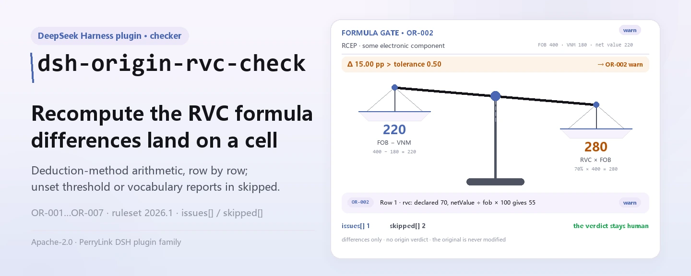

<div align="center">

<picture>
  <source media="(prefers-color-scheme: dark)" srcset="docs/assets/dsh-origin-rvc-check-hero-en-dark.webp">
  
</picture>

# dsh-origin-rvc-check

**उद्गम-निर्धारण रजिस्टर के RVC अंकगणित और घोषित क्षेत्रों की पंक्ति-दर-पंक्ति जाँच करें — और पाएँ कि क्या असंगत है, कहाँ है और क्या सुधारना है।**

उद्गम-प्रमाणपत्र और सीमा-शुल्क कर्मियों के लिए DeepSeek Harness जाँच प्लगइन: नियम-पैक कोई उद्धरण नहीं गढ़ता, केवल वे अंतर सूचीबद्ध करता है जो रजिस्टर स्वयं यांत्रिक रूप से तय कर सकता है, कोई अनुपालन निर्णय नहीं देता, कोई दायित्व नहीं ठहराता, और मूल दस्तावेज़ कभी नहीं बदलता।

[इंस्टॉल](#तीन-चरणों-में-शुरुआत) · [कॉन्फ़िगरेशन](#कॉन्फ़िगरेशन) · [FAQ](#faq) · [简体中文](README.md) · [English](README.en.md) · [Español](README.es.md) · [Português](README.pt.md) · [हिन्दी](README.hi.md)

[](LICENSE)
[](#संगतता)
[](https://www.npmjs.com/package/dsh-origin-rvc-check)
[](https://github.com/PerryLink/dsh-origin-rvc-check/actions/workflows/ci.yml)
[](#संगतता)

[](https://github.com/PerryLink/dsh-origin-rvc-check/stargazers)
[](https://www.npmjs.com/package/dsh-origin-rvc-check)
[](https://dshfind.com/plugins/PerryLink/dsh-origin-rvc-check?ref=badge)
[](https://securityscorecards.dev/viewer/?uri=github.com/PerryLink/dsh-origin-rvc-check)
[](https://dsh.market/)
[](https://gitee.com/perrylink/dsh-origin-rvc-check)

```sh
dsh plugin --profile <name> add dsh-origin-rvc-check
```

</div>

<sub>सामुदायिक प्लगइन, DeepSeek से असंबद्ध। कैनोनिकल रिपॉज़िटरी: <https://github.com/PerryLink/dsh-origin-rvc-check> (Gitee एक मिरर है)।</sub>

## यह क्या है

`dsh-origin-rvc-check` एक उद्गम-निर्धारण रजिस्टर (原产地判定台账) पढ़ता है — समझौते का हेडर और प्रत्येक सामग्री की एक पंक्ति — और उसी रजिस्टर के अपने अंकगणित की जाँच करता है: कि समझौता और उत्पाद घोषित हैं, कि क्षेत्रीय मूल्य-अंश (FOB − गैर-उद्गम सामग्री मूल्य) ÷ FOB × 100 के बराबर है, कि RVC आपकी निर्धारित सीमा तक पहुँचता है, कि प्रत्येक सामग्री अपना उद्गम बताती है, कि उद्गम मानदंड आपके समझौते की शब्दावली से आता है, कि सामग्री क्रमांक दोहराए नहीं गए हैं, और कि विवरण में कोई अप्रतिस्थापित प्लेसहोल्डर शेष नहीं है। आप मूल सामग्री सौंपते हैं (तालिका, रजिस्टर या दस्तावेज़; Excel को पहले JSON/YAML में बदला जा सकता है, चैट में भी यदि प्लेटफ़ॉर्म सहायता करे), और यह बताता है कि क्या असंगत है, कहाँ है और क्या सुधारना है। यह कोई अनुपालन निर्णय नहीं देता, कोई दायित्व नहीं ठहराता, समीक्षक का स्थान नहीं लेता और मूल दस्तावेज़ कभी नहीं बदलता।

<picture>
  <source media="(prefers-color-scheme: dark)" srcset="docs/assets/dsh-origin-rvc-check-flow-v5-dark.svg">
  
</picture>

## तीन चरणों में शुरुआत

1. **इंस्टॉल करें**:

   ```sh
   dsh plugin --profile <name> add dsh-origin-rvc-check
   ```

   यह WorkBuddy / Coze में «Customs Compliance Suite» पैक के भाग के रूप में भी सूचीबद्ध है (यह जाँच उसका एक हिस्सा है; उपलब्धता सूची के अनुसार)।

2. **न्यूनतम कॉन्फ़िग** (डिफ़ॉल्ट से ही चलता है):

   ```yaml
   - insert:
       - id: dsh-origin-rvc-check
         name: dsh-origin-rvc-check
   ```

   सभी समायोज्य विकल्प `src/config.ts` की Schemastery स्कीमा में हैं; डिफ़ॉल्ट तुरंत काम करते हैं। प्रति-नियम सीमाएँ `rules/` के नियम-पैक में हैं।

3. **माउंट सत्यापित करें**:

   ```sh
   dsh --profile <name> --dump-config | grep 'dsh-origin-rvc-check'
   ```

   फिर साथ आई नमूना सामग्री एक बार चलाएँ (लगभग 1 मिनट):

   ```sh
   node samples/quickstart/run.mjs --check
   ```

   नमूना इनपुट `samples/quickstart/input/` में, अपेक्षित आउटपुट `samples/quickstart/expected/result.json` में, और चलाने का स्क्रीनशॉट `docs/assets/quickstart.png` में है।

**अनइंस्टॉल**: `dsh plugin --profile <name> remove dsh-origin-rvc-check` (या प्रोफ़ाइल पैच से वह पंक्ति हटाएँ)।

<details>
<summary>DSH Desktop मार्केट से इंस्टॉल करें</summary>

सभी PerryLink प्लगइन DSH Desktop के अंतर्निहित मार्केट में ब्राउज़ किए जा सकते हैं: **Market → Sources → Add source → पेस्ट करें** `https://perrylink-dsh-catalog.perrylink.workers.dev/catalog-source.json` **→ चुनें**। इंस्टॉलेशन के लिए मार्केट की npm पहचान जाँच और आपकी पुष्टि आवश्यक रहती है।

</details>

## मुख्य क्षमताएँ

प्लगइन `origin_rvc_check` टूल पंजीकृत करता है: एक उद्गम रजिस्टर (समझौते का हेडर और प्रत्येक सामग्री की एक पंक्ति) पढ़ता है, संस्करण-युक्त नियम-पैक लागू करता है और एक संरचित रिपोर्ट देता है।

- **नियम-पैक डेटा है** — सातों जाँचें `rules/origin-rvc-check.yaml` में हैं, इसलिए नियम बदलने पर कोड नहीं बदलता; पैक लोड पर सत्यापित होता है, मान लिया नहीं जाता।
- **केवल रजिस्टर का अपना अंकगणित** — RVC कटौती-सूत्र से दोबारा निकालकर घोषित मान से पंक्ति-दर-पंक्ति तुलना होती है; प्लगइन यह तय नहीं करता कि वह RVC उद्गम पाने के लिए पर्याप्त है या नहीं, और न ही यह कि गणना की परिपाटी सही है या नहीं।
- **गंभीरता प्रमाण के अनुसार** — सिद्धांत-आधारित नियम (`derived-from-principle`) `warn` तक सीमित है; संस्था-कॉन्फ़िगर सीमा (`institutional-configuration`) `info` तक सीमित है; किसी को भी `error` चिह्नित नहीं किया जा सकता (एक परीक्षण इसे प्रमाणित करता है)।
- **खाली सूची का अर्थ «कोई समस्या नहीं» कभी नहीं** — जो जाँच नहीं चल सकी वह `skipped` में कारण के साथ स्वयं को बताती है; जिस नियम की सीमा या शब्दावली अनिर्धारित है वह चुपचाप पास होने के बजाय `skipped` में आता है।
- **कोई निर्णय नहीं** — रिपोर्ट केवल अंतर गिनाती है, अनुपालन, दायित्व या सत्यता पर कभी निर्णय नहीं देती; एक शब्द-रक्षक हर रिपोर्ट पर अस्वीकरण थोपता है।
- **उद्धरण शब्दशः होना चाहिए** — हर नियम में दस्तावेज़, संख्या, धारा, उद्धरण और स्रोत होता है; जब उद्धरण आठ अक्षरों से छोटा हो या सटीक पाठ न मिला हो, तो उद्धरण यही कहता है और नियम `derived-from-principle` चिह्नित होता है — किसी भी पैराफ़्रेज़ को उद्धरण बनाकर नहीं पेश किया जाता।

```text
उद्गम रजिस्टर (समझौता · उत्पाद · सामग्री पंक्तियाँ) ──origin_rvc_check──▶ नियम-पैक OR-001…OR-007 ──▶ रिपोर्ट (findings + skipped)
        ▲                                                                                                        │
        └────────────────────────────────────── मूल कभी नहीं बदलता ──────────────────────────────────────────┘
```

### नियम एक नज़र में

| नियम | जाँच | गंभीरता | आधार प्रकार |
|---|---|---|---|
| `OR-001` | समझौता और उत्पाद घोषित हैं | warn | सिद्धांत |
| `OR-002` | RVC कटौती-सूत्र का पालन करता है | warn | सिद्धांत |
| `OR-003` | RVC आपकी निर्धारित सीमा तक पहुँचता है (डिफ़ॉल्ट रूप से बंद) | info | स्थानीय |
| `OR-004` | हर सामग्री अपना उद्गम बताती है | warn | सिद्धांत |
| `OR-005` | मानदंड आपकी शब्दावली से आता है (डिफ़ॉल्ट रूप से बंद) | info | स्थानीय |
| `OR-006` | सामग्री क्रमांक अद्वितीय हैं | warn | सिद्धांत |
| `OR-007` | विवरण में कोई अप्रतिस्थापित प्लेसहोल्डर नहीं | warn | सिद्धांत |

### उदाहरण

ये प्लगइन के वास्तविक प्रवेश बिंदु हैं; एक बार इंस्टॉल करके एक चलाएँ।

**विस्तृत आउटपुट** — टूल `origin_rvc_check`, इनपुट:

```json
{"product":"某型电子元件","rows":[{"序号":"1","商品编号":"8541400000","品名":"某型电子元件","原产国":"日本","成交价格":"180","币制":"USD","非原产材料价值":"180","是否原产":"否","区域价值成分":"55.00","原产地标准":"RVC"}]}
```

आउटपुट:

```json
{
  "id": "dsh-origin-rvc-check.OR-001.811c9dc5",
  "ruleId": "OR-001",
  "severity": "warn",
  "locator": {
    "field": "agreement"
  },
  "found": "材料表头缺少 agreement",
  "expected": "表头应提供 agreement、product"
}
```

*स्रोत `dsh-origin-rvc-check/tests/fixtures/OR-001/OR-001-unsafe.json`*

### यह किन सवालों का जवाब देता है

| आपका सवाल | इसका जवाब |
|---|---|
| «区域价值成分» कॉलम में `70.00` लिखा है, पर उस पंक्ति का «净价值» `220` है और हेडर का FOB `400` — क्या यह पकड़ में आता है? | हाँ। `OR-002` «净价值» कॉलम और FOB से कटौती-सूत्र (FOB − गैर-उद्गम सामग्री मूल्य) ÷ FOB × 100 दोबारा जोड़ता है, 0.5 अंक की सहनशीलता के साथ, और घोषित RVC मेल न खाने पर वह पंक्ति दर्ज करता है। यह केवल अंकगणित करता है और कटौती पद्धति मान लेता है: जोड़ाई पद्धति से भरा रजिस्टर भी दर्ज होगा, चाहे उसकी अपनी परिपाटी सही हो — इसलिए `expression` बदलें या नियम बंद करें। RVC, «净价值» या FOB में से कोई संख्या के रूप में न पढ़ा जाए तो यह नियम चुपचाप पास होने के बजाय `skipped` में बताता है। |
| कहीं कोई सीमा तय नहीं है और सारी पंक्तियाँ पास हो गईं। क्या RVC की जाँच हुई ही? | नहीं। `OR-003` में `threshold: 0` है, यानी अनिर्धारित, इसलिए यह नियम चुपचाप पास होने के बजाय `skipped` में आता है। `threshold` को अपने समझौते का मान दें (जैसे `40`) तो उससे नीचे रहने वाली हर पंक्ति दर्ज होगी। कोई प्रविष्टि केवल यह बताती है कि मान «आपकी तय सीमा से नीचे» है, यह नहीं कि माल उद्गम-योग्य नहीं है — उद्गम पूर्णतः-प्राप्त या सीमा-वर्गीकरण-परिवर्तन मानदंडों से भी मिल सकता है, और RVC उनमें से केवल एक रास्ता है। |
| एक सामग्री पंक्ति में «原产国» खाली छोड़ दिया गया है। | `OR-004` हर उस पंक्ति को दर्ज करता है जिसमें «原产国» (उद्गम) कॉलम मौजूद है पर खाली है। यह केवल देखता है कि कोष्ठ भरा है; घोषित उद्गम सच है या नहीं, या उससे उद्गम-स्थिति प्रभावित होती है या नहीं, यह नहीं आँकता; जब रजिस्टर में उद्गम का कोई कॉलम ही न हो, तो यह नियम चुपचाप पास होने के बजाय बताता है कि वह लागू नहीं होता। |
| «原产地标准» कॉलम में ऐसा मान है जो मेरी सूची में नहीं है। | `OR-005` हर मान की तुलना पैक की `values` सूची से करता है। वह सूची खाली आती है — मानदंडों के नाम और संक्षेप हर समझौते में बदलते हैं और यह प्लगइन कोई भी नहीं लिखता — और तब यह नियम `skipped` में बताता है; `values` में अपने समझौते के मानदंड भरें (完全获得, CTC, RVC, 特定加工工序 …) तो सूची से बाहर का हर मान दर्ज होगा। यह केवल देखता है कि मान सूची में है, यह नहीं कि माल उस मानदंड को पूरा करता है। |
| एक ही «料件序号» दो पंक्तियों में आया है। | `OR-006` दोहराया गया «料件序号» (itemNo) दर्ज करता है और तुलना करते समय खाली स्थान छोड़ देता है। दोहराव से गैर-उद्गम सामग्री मूल्य दो बार जुड़ता है और इसलिए RVC गलत हो जाता है — यह उस तरह की खोट है जो सीधे गलत निष्कर्ष तक ले जाती है। यह दोहराव दर्ज करता है; दोनों में से कौन-सी पंक्ति गलत है, यह नहीं तय करता। |
| एक पंक्ति के «品名» कॉलम में अब भी `【待填】` लिखा है। | `OR-007` हर उस पंक्ति को दर्ज करता है जिसके «品名» (विवरण) में पैक के `terms` में से कोई प्लेसहोल्डर है: 【, 】, `{{`, `}}`, XXX, xxx, 待填, 待补充, TBD, todo, 示例. टेम्पलेट से उतारा रजिस्टर ऐसा लगता है मानो असली सामग्री की गिनती हो चुकी हो, और RVC ऐसी सामग्री-सूची पर बन जाता है जो है ही नहीं। यह केवल सूचीबद्ध शब्द खोजता है, इसलिए जो प्लेसहोल्डर किसी ने नहीं जोड़ा वह छूट जाता है; `terms` अपने टेम्पलेट के अनुसार बदला जा सकता है। |

## कॉन्फ़िगरेशन

सभी समायोज्य पैरामीटर `src/config.ts` की Schemastery स्कीमा में हैं, इसलिए कोड बदले बिना `cordis.yml` से बदले जा सकते हैं; प्रति-नियम सीमाएँ `rules/` के नियम-पैक में हैं।

| कुंजी | प्रकार | डिफ़ॉल्ट | विवरण |
|---|---|---|---|
| `rulesFile` | string | `rules/origin-rvc-check.yaml` | नियम-पैक का पथ, पैकेज रूट के सापेक्ष; फ़ाइल बदलने से नियम-समुच्चय का संस्करण बदल जाता है |
| `disabledRules` | string[] | `[]` | बंद करने वाले नियम id; प्रत्येक रिपोर्ट के `skipped` में दिखता है |
| `onlyRules` | string[] | `[]` | केवल ये नियम चलाएँ; खाली होने पर सभी नियम चलते हैं |
| `skipNotes` | string | `""` | हर `skipped` कारण के आगे जोड़ी जाने वाली टिप्पणी, जैसे स्थानीय कार्यान्वयन नियम |
| `timeoutMs` | number | `120000` | उपकरण का सहकारी समय-सीमा बजट (मिलीसेकंड) |

जानने योग्य प्रति-नियम पैरामीटर:

- `OR-002` `expression` / `tolerance` — RVC सूत्र, `percent` जो `[netValue, fob]` पर लागू होता है, 0.5 अंक की सहनशीलता के साथ। यदि आपका समझौता जोड़ाई पद्धति रखता है तो इसे जोड़ाई रूप से बदलें।
- `OR-003` `threshold` — आपके समझौते की RVC सीमा, जैसे `40`. `0` का अर्थ है नियम नहीं चलता।
- `OR-005` `values` — आपके समझौते के मानदंड, जैसे `[完全获得, CTC, RVC, 特定加工工序]`. खाली का अर्थ है कोई जाँच नहीं।
- `OR-007` `terms` — खोजे जाने वाले प्लेसहोल्डर।

## FAQ

<details>
<summary>क्या रजिस्टर अपलोड या बदला जाता है?</summary>

नहीं। `dsh-origin-rvc-check` स्थानीय जाँचकर्ता है: यह वही पाठ पढ़ता है जो आप अपने टूल को सौंपते हैं, कुछ अपलोड नहीं करता, कोई नेटवर्क अनुरोध नहीं करता, और कोई टेलीमेट्री, एनालिटिक्स या पृष्ठभूमि रिपोर्टिंग नहीं भेजता। यह टूल परिणाम और DSH होस्ट के अपने सत्र/लॉग स्टोरेज के बाहर कुछ नहीं लिखता; वह स्टोरेज और उसकी अवधि होस्ट नियंत्रित करता है, और यह पैकेज दूसरी प्रति नहीं जोड़ता। मूल दस्तावेज़ कभी नहीं बदलता। यह कथन npm पैकेज पर लागू है, DSH होस्ट या प्रोफ़ाइल के अन्य प्लगइन पर नहीं (देखें `PRIVACY.md`)।

</details>

<details>
<summary>सीमा या शब्दावली कॉन्फ़िगर न होने पर क्या सब चुपचाप पास हो जाता है?</summary>

नहीं। `OR-003` का `threshold` और `OR-005` का `values` दोनों खाली आते हैं, और जो नियम नहीं चल सकता वह कारण के साथ `skipped` में स्वयं को बताता है — अंतरों की खाली सूची को कभी «कुछ गलत नहीं» नहीं पढ़ा जाता। जब RVC, निवल मूल्य या FOB संख्या के रूप में न पढ़ा जाए तो `OR-002` भी वही करता है। यदि रजिस्टर में कोई कॉलम न हो, तो कमी सामान्यतः `skipped` या अनुपस्थित-फ़ील्ड निष्कर्ष के रूप में बताई जाती है, अनुमान नहीं लगाया जाता।

</details>

<details>
<summary>हर निष्कर्ष केवल `warn` या `info` क्यों है?</summary>

रचना से: यह जाँचकर्ता कोई कानूनी, सीमा-शुल्क या अनुपालन निर्णय नहीं देता — यह अंतर और कमियाँ गिनाता है ताकि कोई व्यक्ति तय करे कि क्या करना है। सिद्धांत-आधारित नियम `warn` तक सीमित है; संस्था-कॉन्फ़िगर सीमा `info` तक; लोड पर दोनों के लिए `error` वर्जित है (एक परीक्षण इसे प्रमाणित करता है)।

</details>

<details>
<summary>किसी निष्कर्ष में लिखा है कि धारा का पाठ इस बार प्राप्त नहीं हुआ — क्या यह अनुपालन का प्रमाण है?</summary>

नहीं। नियम-पैक उद्धरण-द्वार का पालन करता है: धारा का पाठ कभी नहीं गढ़ता। जब सटीक पाठ उपलब्ध न हो, निष्कर्ष `warn`/`info` पर रहता है और अपने `excerpt` में यही बताता है (देखें «यह किन मानकों पर आधारित है»)। यह सत्यापन की कमी है, न कि दस्तावेज़ के अनुपालन का प्रमाण — और न ही माल के दोष का।

</details>

<details>
<summary>क्या मैं पूरे वर्ष के रजिस्टर या पूरी निर्देशिका की जाँच कर सकता हूँ?</summary>

हाँ। टूल `native` और `ptc` दोनों में काम करता है; पूरी निर्देशिका के लिए `ptc` चुनें ताकि स्कीमा लागत एक ही बार लगे। सब कुछ स्थानीय रूप से चलता है: समय रजिस्टर की पंक्तियों की संख्या पर निर्भर है, नेटवर्क या मॉडल कॉल पर नहीं।

</details>

## यह किन मानकों पर आधारित है

यह नियम-पैक किसी सार्वजनिक मानक का उद्धरण नहीं देता: सत्यापन को किसी भी मुक्त व्यापार समझौते के उद्गम-नियमों का शब्दशः पाठ नहीं मिला, इसलिए हर नियम का `basis` यही बताता है, सभी `derived-from-principle` हैं और कोई भी `warn` या `info` से ऊपर नहीं जाता। जाँचें जिन पर टिकती हैं वे हैं रजिस्टर का अपना अंकगणित, और लागू समझौते के लिए आपके द्वारा निर्धारित RVC सीमा तथा मानदंड-शब्दावली।

| दस्तावेज़ | संख्यांक | इन्हें उद्धृत करने वाले नियम |
|---|---|---|
| 各自由贸易协定原产地规则（协定文本，本次未取得） | 现行协定版本本次未核实 | OR-001, OR-002, OR-003, OR-004, OR-005, OR-006, OR-007 |

**सीमा:** यह प्लगइन एक **उद्गम-निर्धारण रजिस्टर** (原产地判定台账) के अंकगणित की जाँच करता है — कि समझौता और उत्पाद घोषित हैं, कि क्षेत्रीय मूल्य-अंश (FOB − गैर-उद्गम मूल्य) ÷ FOB × 100 के बराबर है, कि RVC आपकी निर्धारित सीमा तक पहुँचता है, कि हर सामग्री अपना उद्गम बताती है, कि उद्गम मानदंड आपके समझौते की शब्दावली से आता है, कि सामग्री क्रमांक अद्वितीय हैं और कोई प्लेसहोल्डर शेष नहीं है। यह **यह** तय नहीं करता कि माल उद्गम-योग्य है या नहीं, कोई अधिमान्य दर लागू होती है या नहीं, उद्गम घोषणा वैध है या नहीं, या उद्गम-परिवर्जन हुआ या नहीं।

> ### ⚠️ उद्गम नियम संधि-पाठ हैं, और यह पैक किसी का उद्धरण होने का दिखावा नहीं करता
>
> RVC और अन्य उद्गम मानदंड — पूर्णतः प्राप्त, सीमा-वर्गीकरण परिवर्तन — **प्रत्येक मुक्त व्यापार समझौते के अपने उद्गम नियमों** से तय होते हैं। RCEP, ASEAN–China, China–Korea आदि की सीमाएँ (40%, 30% और अन्य स्तर) और गणना-पद्धतियाँ भिन्न हैं। **सत्यापन को किसी समझौते का शब्दशः पाठ नहीं मिला**, इसलिए हर नियम का `basis` यही बताता है और `warn` या `info` पर रहता है।
>
> किसी निष्कर्ष पर भरोसा करने से पहले तीन परिणाम जानने योग्य हैं:
>
> - **`OR-002` कटौती पद्धति मान लेता है** — RVC = (FOB − VNM) ÷ FOB × 100। कुछ समझौते **जोड़ाई** पद्धति (क्षेत्रीय मूल्य ÷ FOB × 100) की अनुमति देते हैं, जो उसी माल के लिए भिन्न संख्या देती है। उस तरह से बना रजिस्टर अंतर दर्ज कराएगा; `expression` बदलें या नियम बंद करें। जाँच हेडर-फ़ॉलबैक से FOB और निवल मूल्य पढ़ती है, इसलिए पूरे समुच्चय के लिए एक बार लिखा आँकड़ा भी मिल जाता है।
> - **`OR-003` की सीमा अनिर्धारित आती है।** सीमाएँ समझौते *और* सीमा-शुल्क पंक्ति के अनुसार बदलती हैं, इसलिए प्लगइन कोई भी हार्डकोड नहीं करता। निष्कर्ष का अर्थ केवल «आपकी तय सीमा से नीचे» है, **यह नहीं** कि «यह माल उद्गम-योग्य नहीं» — क्योंकि उद्गम पूर्णतः-प्राप्त या सीमा-वर्गीकरण-परिवर्तन मानदंडों से भी मिल सकता है। **RVC केवल एक रास्ता है।** यह अंतर महत्वपूर्ण है और नियम का नोट इसे कहता है।
> - **`OR-005` की मानदंड-शब्दावली खाली आती है**; मानदंडों के नाम और संक्षेप हर समझौते में बदलते हैं।

## सामग्री प्रारूप

टूल JSON या YAML स्वीकार करता है:

```yaml
agreement: RCEP
agreementVersion: 2022 年生效文本
exporter: 某某出口有限公司
product: 某型电子元件
fob: '400'
currency: USD
rows:
  - { 序号: '1', 商品编号: '8541400000', 品名: 某型电子元件, 原产国: 日本,
      非原产材料价值: '180', 净价值: '220', 区域价值成分: '55.00', 原产地标准: RVC }
```

कॉलम नाम बिना केस-भेद और खाली स्थान, अंडरस्कोर तथा हाइफ़न छोड़कर मिलाए जाते हैं; रजिस्टर के अपने कॉलम नाम सुरक्षित रहते हैं, इसलिए निष्कर्ष उसी कॉलम का नाम लेता है जिसे उसने पढ़ा। हेडर में एक बार लिखा आँकड़ा — जैसे FOB — अंकगणितीय जाँचों को हेडर-फ़ॉलबैक से मिल जाता है, इसलिए हर पंक्ति में दोहराना आवश्यक नहीं।

पढ़ने की परत में फ़ील्ड वैकल्पिक हैं और जाँच इंजन उन्हें सत्यापित करता है, इसलिए आंशिक निर्यात पर क्रैश के बजाय अनुपस्थित-फ़ील्ड निष्कर्ष मिलते हैं।

## नियमों के स्रोत

नियम-डेटा `rules/origin-rvc-check.yaml` में, कोड से अलग है। चूँकि उद्गम नियम संधि-पाठ हैं जो सत्यापन को नहीं मिले, पैक की `basis` प्रविष्टियाँ किसी समझौते का उद्धरण देने के बजाय यही स्पष्ट कहती हैं। लोडर अब भी प्रति नियम दस्तावेज़, धारा, उद्धरण और स्रोत माँगता है, और अब भी सिद्धांत-व्युत्पन्न या स्थानीय-कॉन्फ़िगर जाँच को `error` घोषित करने से रोकता है।

सत्यापित सीमाएँ और जान-बूझकर **न** कहे गए निष्कर्ष `rules/evidence/` में हैं।

## संगतता

| सतह | स्थिति |
|---|---|
| Harness | peer रेंज `>=0.1.2-rc.1 <0.2.0 \|\| >=0.2.0-0 <0.3.0` — `0.2.0-rc.2` और `0.2.1-rc.2` दोनों को स्वीकार करने के लिए सत्यापित। `engines.dsh` `>=0.2.1-0 <0.3.0` के रूप में घोषित है और 0.2.1 से होस्ट इसे लागू करता है |
| Node | `^22.19.0 \|\| >=24.0.0` |
| प्लेटफ़ॉर्म | सभी (शुद्ध ESM; कोई नेटिव कोड नहीं, कोई नेटवर्क नहीं, कोई मॉडल कॉल नहीं) |
| टूल मोड | `native` और `ptc` में काम करता है; पूरी निर्देशिका के लिए `ptc` चुनें |

## समस्या निवारण

- **`OR-002` हर पंक्ति पर अंतर बताता है।** रजिस्टर जोड़ाई पद्धति से बना है। `expression` बदलें या नियम बंद करें — परिभाषा के अंतर को छिपाने के लिए सहनशीलता न बढ़ाएँ।
- **`OR-002` स्वयं को skipped बताता है।** या तो निवल-मूल्य कॉलम खाली है (जोड़ाई पद्धति उसे खाली छोड़ती है) या FOB नहीं है। जाँच यह अनुमान नहीं लगाती कि कौन-सी परिपाटी लागू है।
- **`OR-003` स्वयं को skipped बताता है।** कोई सीमा निर्धारित नहीं है। सीमाएँ समझौते और सीमा-शुल्क पंक्ति के अनुसार बदलती हैं, इसलिए प्लगइन कोई भी हार्डकोड नहीं करता।
- **`OR-003` अंतर बताता है, पर मुझे लगता है माल उद्गम-योग्य है।** RVC उद्गम का केवल एक रास्ता है। पूर्णतः-प्राप्त या सीमा-वर्गीकरण-परिवर्तन मानदंड अब भी पूरे हो सकते हैं — कोई निष्कर्ष निकालने से पहले लागू समझौते से पुष्टि करें।
- **`OR-006` एक ही सामग्री पर दो बार बताता है।** दोहरा क्रमांक गैर-उद्गम मूल्य को दो बार जोड़ता है और इसलिए RVC बिगाड़ता है। क्रमांक ठीक करें।
- **प्लगइन इंस्टॉल हो गया पर टूल दिखता नहीं।** जाँचें कि `main` `lib/index.mjs` पर जाता है और `pnpm run build` ने उसे बनाया है; गलत `main` लोडर को प्रविष्टि चुपचाप छोड़ने पर मजबूर करता है।
- **`dsh plugin add` असंगत बताकर मना करता है।** peer range `0.1.x` और `0.2.x` दोनों को कवर करती है; बाहर होने पर स्पष्ट छूट दें: `dsh plugin --profile <name> allow-version dsh-origin-rvc-check@0.1.0 --dsh-version <runtime> --accept-risk`
- **कोई नियम नहीं चला।** `skipped` सरणी देखें — उसमें नियम id और कारण लिखा है।
- **`check` में `manifest-peers` विफल दिखता है।** स्थिर जाँचकर्ता 0.2 पंक्ति से पुरानी हार्डकोड peer रेंज से तुलना करता है। रनटाइम इंस्टॉल के समय अनुकूलता लागू करता है, इसलिए घोषित रेंज सही है; यह `dsh-plugin-dev` की ज्ञात अपस्ट्रीम समस्या है।
- **समय खिसका हुआ लगता है।** सारी गणना दिए गए स्ट्रिंग पर वॉल-क्लॉक है; कोई समय-क्षेत्र रूपांतरण नहीं होता।

## इकोसिस्टम और गुणवत्ता

- [Gitee मिरर](https://gitee.com/perrylink/dsh-origin-rvc-check) (सिंक मिरर; GitHub कैनोनिकल है)
- [dshfind प्लगइन पेज](https://dshfind.com/plugins/PerryLink/dsh-origin-rvc-check) (इंस्टॉल और रैंकिंग)
- [OpenSSF Scorecard रिपोर्ट](https://securityscorecards.dev/viewer/?uri=github.com/PerryLink/dsh-origin-rvc-check) ([.github/workflows/scorecard.yml](.github/workflows/scorecard.yml) द्वारा संचालित)
- [DSH Market](https://dsh.market/) (सूचीबद्ध)
- [इकोसिस्टम नॉलेज बेस · सामग्री के अनुसार जाँचकर्ता चुनें](https://perrylink.github.io/zh/checkers/choose/) (पूरा परिवार: 62 जाँचकर्ता + सामान्य प्लगइन)

## डेवलपमेंट

```sh
pnpm install
pnpm run typecheck   # tsc --noEmit
pnpm test            # vitest, प्रति नियम अनुरूप/उल्लंघन फ़िक्स्चर (tests/fixtures/<RULE>/)
pnpm run build       # tsdown -> lib/index.mjs + lib/index.d.mts
pnpm run check:readmes   # पाँच-भाषा README संगति
node ../scripts/sync-shared.mjs dsh-origin-rvc-check   # ../_shared से src/shared ताज़ा करें
```

प्लगइन **डेटा-चालित** है: `src/model.ts` रजिस्टर का स्वरूप घोषित करता है, साझा किट पढ़ने वाला और जाँच इंजन देता है, और नियम-पैक हर जाँच घोषित करता है। अंतिम कमांड `../_shared` से साझा किट `src/shared/` में कॉपी करता है; हर साझा बदलाव के बाद इसे दोबारा चलाएँ।

README की छवियाँ [`scripts/gen-readme-assets.py`](scripts/gen-readme-assets.py) (Python + Pillow) से प्रोग्रामेटिक रूप में बनती हैं और सुरक्षित रूप से दोबारा चलाई जा सकती हैं। इस प्लगइन में UI नहीं है, इसलिए hero Pillow से बनाया गया RVC तराज़ू है (zh/en × हल्का/गहरा, चार फ़ाइलें) और संरचना-चित्र हाथ से लिखा SVG गणना-बेंच है (हल्का और गहरा संस्करण)।

Topics: `dsh`, `dsh-plugin`, `deepseek-harness`, `deepseek`, `cordis`, `origin`, `rvc`

## परिवार और आभार

यह प्रोजेक्ट [PerryLink](https://github.com/PerryLink) के DeepSeek Harness प्लगइन परिवार का हिस्सा है (सभी Apache-2.0)। अगर यह उपयोगी लगे, तो **एक स्टार अगले व्यक्ति को इसे खोजने में मदद करता है** — इसके पीछे कुछ भी लॉक नहीं है।

- [@PerryLink](https://github.com/PerryLink) — निर्माता और रखरखावकर्ता: `origin_rvc_check` टूल, 7-नियम पैक और उसका धारा-सत्यापन रिकॉर्ड, और पाँच-भाषा दस्तावेज़।

<details>
<summary>सभी प्लगइन खोलें</summary>

| प्लगइन | स्थिति |
|---|---|
| **[dsh-aqua-input-check](https://github.com/PerryLink/dsh-aqua-input-check)** |  |
| **[dsh-archive-check](https://github.com/PerryLink/dsh-archive-check)** |  |
| **[dsh-auto-review](https://github.com/PerryLink/dsh-auto-review)** |  |
| **[dsh-autotier](https://github.com/PerryLink/dsh-autotier)** | 🧊 फ़्रोज़न — रेपो README देखें |
| **[dsh-bid-ca-precheck](https://github.com/PerryLink/dsh-bid-ca-precheck)** |  |
| **[dsh-bid-qual-check](https://github.com/PerryLink/dsh-bid-qual-check)** |  |
| **[dsh-cert-mcp](https://github.com/PerryLink/dsh-cert-mcp)** | 🧊 फ़्रोज़न — रेपो README देखें |
| **[dsh-checkpoint-rewind](https://github.com/PerryLink/dsh-checkpoint-rewind)** |  |
| **[dsh-click](https://github.com/PerryLink/dsh-click)** |  |
| **[dsh-composer-history](https://github.com/PerryLink/dsh-composer-history)** |  |
| **[dsh-contract-stance](https://github.com/PerryLink/dsh-contract-stance)** |  |
| **[dsh-customs-doc-check](https://github.com/PerryLink/dsh-customs-doc-check)** |  |
| **[dsh-data-quality](https://github.com/PerryLink/dsh-data-quality)** | 🧊 फ़्रोज़न — रेपो README देखें |
| **[dsh-demurrage-ledger](https://github.com/PerryLink/dsh-demurrage-ledger)** |  |
| **[dsh-doublecheck](https://github.com/PerryLink/dsh-doublecheck)** |  |
| **[dsh-drill-script-check](https://github.com/PerryLink/dsh-drill-script-check)** |  |
| **[dsh-eia-guide-check](https://github.com/PerryLink/dsh-eia-guide-check)** |  |
| **[dsh-emergency-plan](https://github.com/PerryLink/dsh-emergency-plan)** |  |
| **[dsh-essay-rubric-check](https://github.com/PerryLink/dsh-essay-rubric-check)** |  |
| **[dsh-evidence-check](https://github.com/PerryLink/dsh-evidence-check)** |  |
| **[dsh-export-ctl-check](https://github.com/PerryLink/dsh-export-ctl-check)** |  |
| **[dsh-fast](https://github.com/PerryLink/dsh-fast)** |  |
| **[dsh-fmea-table-check](https://github.com/PerryLink/dsh-fmea-table-check)** |  |
| **[dsh-forecast-penalty](https://github.com/PerryLink/dsh-forecast-penalty)** |  |
| **[dsh-fund-research](https://github.com/PerryLink/dsh-fund-research)** |  |
| **[dsh-github](https://github.com/PerryLink/dsh-github)** |  |
| **[dsh-gongwen-flow-check](https://github.com/PerryLink/dsh-gongwen-flow-check)** |  |
| **[dsh-gongwen-word-check](https://github.com/PerryLink/dsh-gongwen-word-check)** |  |
| **[dsh-guard-plan-qc](https://github.com/PerryLink/dsh-guard-plan-qc)** |  |
| **[dsh-hazchem-check](https://github.com/PerryLink/dsh-hazchem-check)** |  |
| **[dsh-hazplan-check](https://github.com/PerryLink/dsh-hazplan-check)** |  |
| **[dsh-hidden-risk-map](https://github.com/PerryLink/dsh-hidden-risk-map)** |  |
| **[dsh-hs-classify](https://github.com/PerryLink/dsh-hs-classify)** |  |
| **[dsh-icd-rule-check](https://github.com/PerryLink/dsh-icd-rule-check)** |  |
| **[dsh-industry-research](https://github.com/PerryLink/dsh-industry-research)** |  |
| **[dsh-lawcite-adapter](https://github.com/PerryLink/dsh-lawcite-adapter)** |  |
| **[dsh-laya](https://github.com/PerryLink/dsh-laya)** |  |
| **[dsh-lc-doc-check](https://github.com/PerryLink/dsh-lc-doc-check)** |  |
| **[dsh-learning-gap-check](https://github.com/PerryLink/dsh-learning-gap-check)** |  |
| **[dsh-library](https://github.com/PerryLink/dsh-library)** |  |
| **[dsh-local-ai](https://github.com/PerryLink/dsh-local-ai)** |  |
| **[dsh-lsp-actions](https://github.com/PerryLink/dsh-lsp-actions)** |  |
| **[dsh-mask](https://github.com/PerryLink/dsh-mask)** |  |
| **[dsh-mcp-panel](https://github.com/PerryLink/dsh-mcp-panel)** |  |
| **[dsh-medrec-qc](https://github.com/PerryLink/dsh-medrec-qc)** |  |
| **[dsh-memento](https://github.com/PerryLink/dsh-memento)** | 🧊 फ़्रोज़न — रेपो README देखें |
| **[dsh-nsfc-form-check](https://github.com/PerryLink/dsh-nsfc-form-check)** |  |
| **[dsh-nurse-record-check](https://github.com/PerryLink/dsh-nurse-record-check)** |  |
| **[dsh-observe](https://github.com/PerryLink/dsh-observe)** |  |
| **[dsh-origin-rvc-check](https://github.com/PerryLink/dsh-origin-rvc-check)** |  |
| **[dsh-ota-review-check](https://github.com/PerryLink/dsh-ota-review-check)** |  |
| **[dsh-output-styles](https://github.com/PerryLink/dsh-output-styles)** |  |
| **[dsh-paper-doc-adapter](https://github.com/PerryLink/dsh-paper-doc-adapter)** |  |
| **[dsh-permission-rules](https://github.com/PerryLink/dsh-permission-rules)** |  |
| **[dsh-permit-report-check](https://github.com/PerryLink/dsh-permit-report-check)** |  |
| **[dsh-pipeline-check](https://github.com/PerryLink/dsh-pipeline-check)** |  |
| **[dsh-pleading-draft](https://github.com/PerryLink/dsh-pleading-draft)** |  |
| **[dsh-plugin-doctor](https://github.com/PerryLink/dsh-plugin-doctor)** | 🚫 रिटायर्ड (रेपो संग्रहीत) |
| **[dsh-plugin-guide](https://github.com/PerryLink/dsh-plugin-guide)** |  |
| **[dsh-plugin-kit](https://github.com/PerryLink/dsh-plugin-kit)** | 🚫 रिटायर्ड (रेपो संग्रहीत) |
| **[dsh-plugin-upgrade](https://github.com/PerryLink/dsh-plugin-upgrade)** | 🚫 रिटायर्ड (रेपो संग्रहीत) |
| **[dsh-policy-brief-draft](https://github.com/PerryLink/dsh-policy-brief-draft)** |  |
| **[dsh-power-loss-split](https://github.com/PerryLink/dsh-power-loss-split)** |  |
| **[dsh-power-ticket-check](https://github.com/PerryLink/dsh-power-ticket-check)** |  |
| **[dsh-ppap-check](https://github.com/PerryLink/dsh-ppap-check)** |  |
| **[dsh-protest-deadline](https://github.com/PerryLink/dsh-protest-deadline)** |  |
| **[dsh-railway-window](https://github.com/PerryLink/dsh-railway-window)** |  |
| **[dsh-repair-order-qc](https://github.com/PerryLink/dsh-repair-order-qc)** |  |
| **[dsh-research-report](https://github.com/PerryLink/dsh-research-report)** |  |
| **[dsh-review-reply-check](https://github.com/PerryLink/dsh-review-reply-check)** |  |
| **[dsh-rulefile-check](https://github.com/PerryLink/dsh-rulefile-check)** |  |
| **[dsh-safety-brief-check](https://github.com/PerryLink/dsh-safety-brief-check)** |  |
| **[dsh-score](https://github.com/PerryLink/dsh-score)** | 🧊 फ़्रोज़न — रेपो README देखें |
| **[dsh-session-sync](https://github.com/PerryLink/dsh-session-sync)** |  |
| **[dsh-site-log-check](https://github.com/PerryLink/dsh-site-log-check)** |  |
| **[dsh-skill-pack-security](https://github.com/PerryLink/dsh-skill-pack-security)** |  |
| **[dsh-soe-decision-check](https://github.com/PerryLink/dsh-soe-decision-check)** |  |
| **[dsh-soilwater-check](https://github.com/PerryLink/dsh-soilwater-check)** |  |
| **[dsh-sop-sync-check](https://github.com/PerryLink/dsh-sop-sync-check)** |  |
| **[dsh-spc-gbt-adapter](https://github.com/PerryLink/dsh-spc-gbt-adapter)** |  |
| **[dsh-talk](https://github.com/PerryLink/dsh-talk)** |  |
| **[dsh-tender-extract](https://github.com/PerryLink/dsh-tender-extract)** |  |
| **[dsh-tender-matrix](https://github.com/PerryLink/dsh-tender-matrix)** |  |
| **[dsh-test-drive](https://github.com/PerryLink/dsh-test-drive)** |  |
| **[dsh-ticktick](https://github.com/PerryLink/dsh-ticktick)** | 🚫 रिटायर्ड (रेपो संग्रहीत) |
| **[dsh-translate](https://github.com/PerryLink/dsh-translate)** |  |
| **[dsh-warranty-calc](https://github.com/PerryLink/dsh-warranty-calc)** |  |
| **[dsh-budget](https://github.com/PerryLink/dsh-budget)** | 🧊 फ़्रोज़न — रेपो README देखें |
| **[dsh-claude-move](https://github.com/PerryLink/dsh-claude-move)** | 🧊 फ़्रोज़न — रेपो README देखें |
| **[dsh-defend](https://github.com/PerryLink/dsh-defend)** | 🧊 फ़्रोज़न — रेपो README देखें |
| **[dsh-draw](https://github.com/PerryLink/dsh-draw)** | 🧊 फ़्रोज़न — रेपो README देखें |
| **[dsh-reach](https://github.com/PerryLink/dsh-reach)** | 🧊 फ़्रोज़न — रेपो README देखें |
| **[dsh-background-agents](https://github.com/PerryLink/dsh-background-agents)** | 🚫 रिटायर्ड (रेपो संग्रहीत) |
| **[dsh-session-pin](https://github.com/PerryLink/dsh-session-pin)** | 🚫 रिटायर्ड (रेपो संग्रहीत) |
| **[dsh-team-rooms](https://github.com/PerryLink/dsh-team-rooms)** | 🚫 रिटायर्ड (रेपो संग्रहीत) |

</details>

## लाइसेंस

[LICENSE](LICENSE) (Apache License 2.0) © 2026 dsh-origin-rvc-check contributors

<p align="center"><sub>Apache-2.0 · सामुदायिक प्लगइन, DeepSeek से असंबद्ध।</sub></p>
