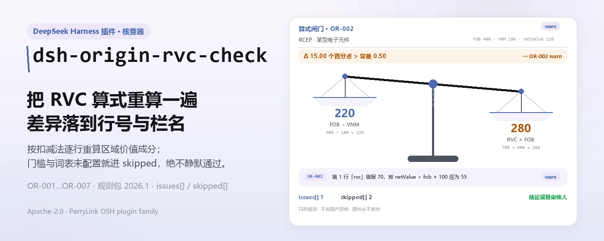
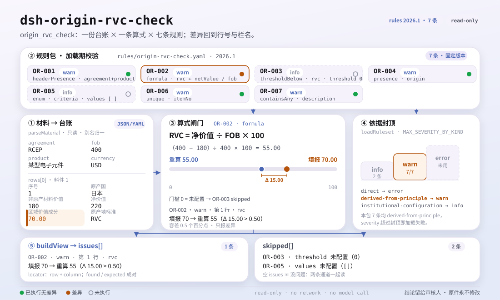

<div align="center">

<picture>
  <source media="(prefers-color-scheme: dark)" srcset="docs/assets/dsh-origin-rvc-check-hero-zh-dark.webp">
  
</picture>

# dsh-origin-rvc-check

**逐行核对原产地判定台账的区域价值成分算术与申报口径——输出「哪一行、哪一栏、差什么」的清单。**

面向原产地证申领与关务人员的 DeepSeek Harness 检查插件：规则包不伪造引文，只列台账自身可机械判定的差异，不下合规结论、不认定责任、不替代审核人，也绝不修改原件。

[安装](#三步上手) · [配置](#配置) · [FAQ](#faq) · [简体中文](README.md) · [English](README.en.md)

[](LICENSE)
[](#兼容性)
[](https://www.npmjs.com/package/dsh-origin-rvc-check)
[](https://github.com/PerryLink/dsh-origin-rvc-check/actions/workflows/ci.yml)
[](#兼容性)

[](https://github.com/PerryLink/dsh-origin-rvc-check/stargazers)
[](https://www.npmjs.com/package/dsh-origin-rvc-check)
[](https://dshfind.com/plugins/PerryLink/dsh-origin-rvc-check?ref=badge)
[](https://securityscorecards.dev/viewer/?uri=github.com/PerryLink/dsh-origin-rvc-check)
[](https://dsh.market/)
[](https://gitee.com/perrylink/dsh-origin-rvc-check)

```sh
dsh plugin --profile <name> add dsh-origin-rvc-check
```

</div>

<sub>社区插件，与 DeepSeek 官方无关。唯一仓库：<https://github.com/PerryLink/dsh-origin-rvc-check>（Gitee 为镜像）。</sub>

## 它是什么

`dsh-origin-rvc-check` 读取一份原产地判定台账——表头写明协定与产品，每种料件一行——核对这份台账自身的算术：协定与产品是否声明、区域价值成分是否等于 (FOB − 非原产材料价值) ÷ FOB × 100、RVC 是否达到你配置的门槛、每条料件是否填写原产国、原产地标准是否出自你所适用协定的口径、料件序号是否唯一、品名栏是否残留未替换的占位符。你交出原始材料（表格、清单或文书；Excel 可先转成 JSON/YAML，对话里也能代转），它返回一份「哪一行、哪一栏、差什么」的差异清单。它不下合规结论、不认定责任、不替代审核人，也绝不修改原件。

<picture>
  <source media="(prefers-color-scheme: dark)" srcset="docs/assets/dsh-origin-rvc-check-flow-v5-dark.svg">
  
</picture>

## 三步上手

1. **安装**：

   ```sh
   dsh plugin --profile <name> add dsh-origin-rvc-check
   ```

   也可以在 WorkBuddy / 扣子搜「关务合规核对包」（本检查是其中一项；上架以商城为准）。

2. **最小配置**（默认即可用）：

   ```yaml
   - insert:
       - id: dsh-origin-rvc-check
         name: dsh-origin-rvc-check
   ```

   全部可调项都在 `src/config.ts` 的 Schemastery schema 里，默认值开箱即用；逐条阈值在 `rules/` 下的规则包里。

3. **验证已生效**：

   ```sh
   dsh --profile <name> --dump-config | grep 'dsh-origin-rvc-check'
   ```

   再用自带样例跑一次（约 1 分钟）：

   ```sh
   node samples/quickstart/run.mjs --check
   ```

   样例输入在 `samples/quickstart/input/`，期望输出在 `samples/quickstart/expected/result.json`，运行截图见 `docs/assets/quickstart.png`。

**卸载**：`dsh plugin --profile <name> remove dsh-origin-rvc-check`（或从 profile patch 删掉该行）。

<details>
<summary>从 DSH Desktop 市场安装</summary>

所有 PerryLink 插件均可在 DSH Desktop 内置市场中浏览：**市场 → 来源 → 添加来源 → 粘贴** `https://perrylink-dsh-catalog.perrylink.workers.dev/catalog-source.json` **→ 选中**。安装仍需通过市场的 npm 身份校验与你的确认。

</details>

## 核心能力

本插件注册 `origin_rvc_check` 工具：读入一份原产地判定台账（协定表头 + 每种料件一行），套用带版本的规则包，返回一份结构化报告。

- **规则包即数据** —— 7 条检查全部在 `rules/origin-rvc-check.yaml` 里，换规则不动代码；规则包在加载期校验，而非被信任。
- **只做台账自身的算术** —— RVC 按扣减法定义式重算，与填报值逐行比对；它不判断该 RVC 是否足以取得原产资格，也不判断计算口径是否正确。
- **严重级跟着依据走** —— 依据为原则性条款（`derived-from-principle`）的规则封顶 `warn`；依据为本机构配置（`institutional-configuration`）的阈值封顶 `info`；绝不会把原则或本地配置标成 `error`（有测试断言）。
- **空清单不等于没问题** —— 每一项无法执行的检查都会在 `skipped` 里自报原因；门槛或标准词表未配置的规则自报 `skipped`，而不是静默通过。
- **不裁决** —— 报告只列差异，永不判定合规、责任或对错；措辞守卫强制报告始终携带免责声明。
- **引文必须逐字** —— 每条规则带文件名、文号、条款号、逐字摘录与来源链接；摘录不足八个字符或无法取得原文时，在摘录里明说并把规则标记为 `derived-from-principle`，绝不把转述包装成引文。

```text
原产地判定台账（协定 · 产品 · 料件行）──origin_rvc_check──▶ 规则包 OR-001…OR-007 ──▶ 报告（findings + skipped）
        ▲                                                                                   │
        └──────────────────────────────── 原件永不修改 ────────────────────────────────────┘
```

### 规则一览

| 规则 | 核对内容 | 严重级 | 依据类型 |
|---|---|---|---|
| `OR-001` | 协定与产品已声明 | warn | 原则性条款 |
| `OR-002` | RVC 符合扣减法定义式 | warn | 原则性条款 |
| `OR-003` | RVC 达到你配置的门槛（默认关闭） | info | 本机构配置 |
| `OR-004` | 每条料件都填写原产国 | warn | 原则性条款 |
| `OR-005` | 原产地标准出自你的词表（默认关闭） | info | 本机构配置 |
| `OR-006` | 料件序号唯一 | warn | 原则性条款 |
| `OR-007` | 品名不含未替换占位符 | warn | 原则性条款 |

### 示例

以下为插件真实入口；安装后调用一次即可。

**详细输出** — 工具 `origin_rvc_check`，输入：

```json
{"product":"某型电子元件","rows":[{"序号":"1","商品编号":"8541400000","品名":"某型电子元件","原产国":"日本","成交价格":"180","币制":"USD","非原产材料价值":"180","是否原产":"否","区域价值成分":"55.00","原产地标准":"RVC"}]}
```

输出：

```json
{
  "id": "dsh-origin-rvc-check.OR-001.811c9dc5",
  "ruleId": "OR-001",
  "severity": "warn",
  "locator": {
    "field": "agreement"
  },
  "found": "材料表头缺少 agreement",
  "expected": "表头应提供 agreement、product"
}
```

*Observed from `dsh-origin-rvc-check/tests/fixtures/OR-001/OR-001-unsafe.json`*

### 它回答什么问题

| 你会问 | 它怎么答 |
|---|---|
| 「区域价值成分」栏填的是 `70.00`，但该行「净价值」是 `220`、表头 FOB 是 `400`，这种情况查得出来吗？ | 查得出来。`OR-002` 拿「净价值」栏与 FOB 按扣减法 (FOB − 非原产材料价值) ÷ FOB × 100 重算，容差 0.5 个百分点，填报值与之不符即逐行报出。它只做算术，而且按扣减法核对：台账若按累加法填写，即使口径本身正确也会被报出差异，此时请改 `expression` 或停用本条。RVC、净价值、FOB 有一项读不成数值时，本条报告「无法执行」，不会静默通过。 |
| 台账里没有任何地方设置门槛，结果每行都通过了——它到底核对了 RVC 没有？ | 没有。`OR-003` 的 `threshold` 出厂为 `0`，表示未配置，本条会报在 `skipped` 里，而不是静默通过。把它改成你所适用协定的门槛（例如 `40`），低于该值的行才会被报出。命中只表示「低于你配置的门槛」，**不表示**该货物不具备原产资格——原产资格还可以由完全获得、税则归类改变等标准取得，RVC 只是其中一条路径。 |
| 有一行料件的「原产国」栏是空的。 | `OR-004` 会报出「原产国」栏存在但为空的每一行。它只核对这一栏是否填写，不判断申报的原产国是否真实、是否会影响原产资格；台账里根本没有原产国这一栏时，本条报告「不适用」，而不是静默通过。 |
| 「原产地标准」栏填了一个不在我清单里的值。 | `OR-005` 拿它和规则库的 `values` 逐个比对。`values` 出厂为空——原产地标准的名称与缩写随协定变化，本插件不硬编码——此时本条报告「无法执行」；把 `values` 填成你所适用协定的口径（完全获得、CTC、RVC、特定加工工序等）后，不在册的值即被报出。它只核对所填值是否在册，不判断该批货物是否满足该标准。 |
| 同一个「料件序号」出现在两行上。 | `OR-006` 会报出重复的「料件序号」，比较时忽略空白字符。序号重复会让非原产材料价值被重复计入合计，进而使 RVC 算错——这是会直接导致错误结论的那类缺陷。它只报出重复；两行中哪一行填错了，它不判断。 |
| 有一行的「品名」栏还写着 `【待填】`。 | `OR-007` 会报出品名中含规则库 `terms` 所列占位符的行——【、】、`{{`、`}}`、XXX、xxx、待填、待补充、TBD、todo、示例。照抄模板的台账看上去像已经盘点了实际料件，而 RVC 会算在一份并不存在的料件清单上。它只找列出的这些词，清单之外的占位符会漏过；`terms` 可按本机构模板调整。 |

## 配置

全部可调参数都在 `src/config.ts` 的 Schemastery schema 中，只改 `cordis.yml` 即可生效，无需改代码；逐条阈值在 `rules/` 下的规则库文件里。

| 键 | 类型 | 默认值 | 说明 |
|---|---|---|---|
| `rulesFile` | string | `rules/origin-rvc-check.yaml` | 规则库文件路径，相对插件包根目录；替换该文件即可切换规则集版本 |
| `disabledRules` | string[] | `[]` | 要停用的规则 id 列表；停用的规则会出现在报告的 `skipped` 中 |
| `onlyRules` | string[] | `[]` | 只执行这些规则 id；留空表示执行全部规则 |
| `skipNotes` | string | `""` | 附加到每条 `skipped` 说明后的备注，例如标注本机构实施细则 |
| `timeoutMs` | number | `120000` | 工具协作式超时预算（毫秒） |

值得知道的规则级参数：

- `OR-002` `expression` / `tolerance` —— RVC 公式，`percent` 作用于 `[netValue, fob]`，容差 0.5 个百分点。协定用累加法时替换为累加形式。
- `OR-003` `threshold` —— 你所适用协定的 RVC 门槛，例如 `40`；`0` 表示本条不执行。
- `OR-005` `values` —— 你所适用协定的原产地标准，例如 `[完全获得, CTC, RVC, 特定加工工序]`；为空表示不核对。
- `OR-007` `terms` —— 要找的占位符。

## FAQ

<details>
<summary>台账会被上传或改动吗？</summary>

不会。`dsh-origin-rvc-check` 是本地检查器：它只读取你交给工具的文本，不上传、不发网络请求、不带遥测或后台上报。它只在工具结果与 DSH 宿主自己的会话/日志存储里留下内容，宿主控制那份存储与保留期，本包不另存第二份；原件也不会被修改。以上声明覆盖 npm 包本身，不覆盖 DSH 宿主或 profile 里的其他插件（详见 `PRIVACY.md`）。

</details>

<details>
<summary>没配门槛或标准词表时，会不会静默通过？</summary>

不会。`OR-003` 的 `threshold` 与 `OR-005` 的 `values` 出厂均为空，未配置的规则会把自己报进 `skipped` 并写明原因——空的差异清单不会被读成「没有问题」。`OR-002` 读不到 RVC、净价值或 FOB 时同样进 `skipped`。台账缺栏目时，缺项通常也作为 `skipped` 或「缺项」类发现出现，而不是猜一个结论。

</details>

<details>
<summary>为什么所有发现都是 `warn` 或 `info`？</summary>

设计如此：本插件不做法律、海关或合规定性，只列差异与缺口。依据是原则性条款的规则封顶 `warn`，依据是本机构配置的阈值封顶 `info`；规则包在加载期就禁止把这两类标成 `error`（有测试断言）。每一条发现都应交由人来判断如何处理。

</details>

<details>
<summary>一条发现写着「条款原文本次未取得」，还能当合规证据吗？</summary>

不能。规则包遵守引文闸门：绝不伪造条款原文；原文未取得时，发现停留在 `warn` 或 `info`，并在 `excerpt` 里明说这一点（见「依据的标准」）。这是核验缺口，不是「材料合规」的证明，也不代表该批货物一定有问题。

</details>

<details>
<summary>一整年的台账或整个目录批量核，跑得动吗？</summary>

可以。工具在 `native` 与 `ptc` 两种模式下都可用；批量校验整个目录时建议 `ptc`，schema 成本只付一次。检查全部在本地完成，耗时取决于台账行数，不依赖网络或模型调用。

</details>

## 依据的标准

本规则库不引用任何公开标准：核验未取得任何自由贸易协定原产地规则的逐字条文，因此每条规则的 `basis` 都如实写明这一点，`kind` 一律为 `derived-from-principle`、严重度封顶 `warn` 或 `info`。它依据的是台账自身的算术自洽，以及你按适用协定配置的 RVC 门槛与原产地标准口径。

| 文件 | 文号 | 引用它的规则 |
|---|---|---|
| 各自由贸易协定原产地规则（协定文本，本次未取得） | 现行协定版本本次未核实 | OR-001, OR-002, OR-003, OR-004, OR-005, OR-006, OR-007 |

**边界：** 本插件核对一份**原产地判定台账**的算术——是否声明协定与产品，区域价值成分是否等于（FOB − 非原产材料价值）÷ FOB × 100，RVC 是否达到你配置的门槛，每种材料是否写明其原产地，原产地标准是否取自你所适用协定的取值口径，材料编号是否唯一，以及是否残留占位符。它**不**判定货物是否具备原产资格、是否适用优惠税率、原产地声明是否有效，也不判定是否发生原产地规避。

> ### ⚠️ 原产地规则是条约文本，本规则库不假装引用其中任何一条
>
> RVC 以及其他原产地标准——完全获得、税则归类改变——由**各自由贸易协定自己的原产地规则**设定。RCEP、中国—东盟、中国—韩国等协定在阈值上（40%、30% 及其他档次）和计算方法上都各不相同。**核验环节没有从任何协定中取得逐字原文**，因此每条规则的 `basis` 都如实写明这一点，并停留在 `warn` 或 `info`。
>
> 在信任一项发现之前，有三点后果值得了解：
>
> - **`OR-002` 假定的是扣减法**——RVC = (FOB − VNM) ÷ FOB × 100。有些协定允许**累加法**（区域价值 ÷ FOB × 100），对同样的货物会得出不同的数值。按那种方法计算的台账会被报出差异；请修改 `expression` 或停用该规则。该项检查通过表头回退来读取 FOB 和净价值，因此整套数据只声明一次的数值也能被找到。
> - **`OR-003` 的阈值出厂时未设定。** 阈值因协定*和*税则行而异，因此本插件不硬编码任何阈值。一项发现的意思是「低于你设定的阈值」，**而不是**「这些货物非原产」——因为原产地也可以通过完全获得或税则归类改变标准取得。**RVC 只是其中一条路径。** 这一区分很重要，该规则的说明也写明了它。
> - **`OR-005` 的标准词表出厂为空**；标准名称和缩写因协定而异。

## 材料格式

工具接受 JSON 或 YAML：

```yaml
agreement: RCEP
agreementVersion: 2022 年生效文本
exporter: 某某出口有限公司
product: 某型电子元件
fob: '400'
currency: USD
rows:
  - { 序号: '1', 商品编号: '8541400000', 品名: 某型电子元件, 原产国: 日本,
      非原产材料价值: '180', 净价值: '220', 区域价值成分: '55.00', 原产地标准: RVC }
```

栏目名按大小写不敏感、忽略空格、下划线与连字符的方式匹配；台账自己的栏目名会被保留，因此发现会指名它读取的那一栏。只声明一次的表头数值——例如 FOB——会被算术检查通过表头回退找到，无需每行重复。

字段在读取层是可选的，由检查引擎校验，因此部分导出的材料会产生「缺项」类差异，而不是让程序崩溃。

## 规则来源

规则数据在 `rules/origin-rvc-check.yaml`，与代码分离。因为原产地规则是核验环节无法取得的条约文本，规则包的 `basis` 条目逐条写明这一点，而不是引用某个协定。加载期闸门仍要求每条规则给出文件名、文号、按原文自身编号体系的条款号、逐字摘录与来源，并且禁止把原则性推论或本机构配置的检查标成 `error`。

核验中确认的边界与"刻意没有作出的结论"见 `rules/evidence/` 目录。

## 兼容性

| 项目 | 状态 |
|---|---|
| Harness | 对等版本范围 `>=0.1.2-rc.1 <0.2.0 \|\| >=0.2.0-0 <0.3.0` —— 已实测同时接受 `0.2.0-rc.2` 与 `0.2.1-rc.2`。已声明 `engines.dsh`：`>=0.2.1-0 <0.3.0`，0.2.1 起由宿主单独裁决 |
| Node | `^22.19.0 \|\| >=24.0.0` |
| 平台 | 全平台（纯 ESM；无原生代码、无联网、不调用模型） |
| 工具模式 | `native` / `ptc` 均可；批量校验整个目录时建议 `ptc`，schema 成本只付一次 |

## 故障排查

- **`OR-002` 每一行都报差异。** 台账按累加法计算。改 `expression`，或停用本条——不要靠放大容差来掩盖口径不一致。
- **`OR-002` 自报 skipped。** 要么「净价值」栏为空（累加法会留空），要么缺少 FOB。这项检查不会替你猜该用哪种口径。
- **`OR-003` 自报 skipped。** 没有配置门槛。门槛因协定与税则行而异，本插件不硬编码任何值。
- **`OR-003` 报出差异，但我认为货物具备原产资格。** RVC 只是取得原产资格的一条路径。完全获得或税则归类改变标准仍可能满足——下结论前请对照适用协定确认。
- **`OR-006` 对同一料件报两次。** 序号重复会让非原产材料价值被重复计入，进而使 RVC 算错。改正序号。
- **插件装上了但工具不出现。** 确认 `main` 指向 `lib/index.mjs` 且 `pnpm run build` 已生成该文件；`main` 写错会让加载器静默跳过该条目。
- **`dsh plugin add` 以不兼容为由拒绝。** peer 范围覆盖 `0.1.x` 与 `0.2.x`；若运行时在其之外，可显式豁免：`dsh plugin --profile <name> allow-version dsh-origin-rvc-check@0.1.0 --dsh-version <runtime> --accept-risk`
- **某条规则没有执行。** 查看 `skipped` 数组，其中写明了规则 id 与原因。
- **`check` 报 `manifest-peers` 失败。** 静态检查器比对的是一份早于 0.2 世代的硬编码 peer 范围；安装期的 peer 校验以运行时为准，声明的范围才是正确的。这是 `dsh-plugin-dev` 的已知上游问题。
- **时间看起来偏移。** 全部计算都是对输入字符串做墙上时钟运算，不做时区换算。

## 生态与质量

- [Gitee 镜像](https://gitee.com/perrylink/dsh-origin-rvc-check)（同步镜像，以 GitHub 为准）
- [dshfind 插件页](https://dshfind.com/plugins/PerryLink/dsh-origin-rvc-check)（安装量与排名）
- [OpenSSF Scorecard 报告](https://securityscorecards.dev/viewer/?uri=github.com/PerryLink/dsh-origin-rvc-check)（由 [.github/workflows/scorecard.yml](.github/workflows/scorecard.yml) 驱动）
- [DSH Market](https://dsh.market/)（已上架）
- [生态实测知识库 · 按材料选核查器](https://perrylink.github.io/zh/checkers/choose/)（完整家族清单：62 个核查器 + 通用插件）

## 开发

```sh
pnpm install
pnpm run typecheck   # tsc --noEmit
pnpm test            # vitest，每条规则配对正/反夹具（tests/fixtures/<RULE>/）
pnpm run build       # tsdown -> lib/index.mjs + lib/index.d.mts
pnpm run check:readmes   # 五语 README 一致性
node ../scripts/sync-shared.mjs dsh-origin-rvc-check   # 从 ../_shared 刷新 src/shared
```

插件是**数据驱动**的：`src/model.ts` 声明台账形态，共享件提供读取器与检查引擎，规则包声明每一项检查。最后一条命令把 `../_shared` 的共享件同步进 `src/shared/`；每次改动共享件后都要重跑。

README 配图由 [`scripts/gen-readme-assets.py`](scripts/gen-readme-assets.py) 程序化生成（Python + Pillow），可重复执行；本插件无 UI，hero 为 Pillow 绘制的「RVC 天平」图（中英 × 深浅四版），结构图为手绘 SVG 核算台（深浅双版）。

Topics：`dsh`, `dsh-plugin`, `deepseek-harness`, `deepseek`, `cordis`, `origin`, `rvc`

## 家族与致谢

本项目是 [PerryLink](https://github.com/PerryLink) 维护的 DeepSeek Harness 插件家族成员（全部 Apache-2.0）。如果这个插件帮到了你，**给个 star**——它不解锁任何功能，但会让下一个人更容易找到它。

- [@PerryLink](https://github.com/PerryLink) —— 创建者与维护者：`origin_rvc_check` 工具、7 条规则的规则包与条款核验记录、五语文档。

<details>
<summary>展开全部插件</summary>

| 插件 | 状态 |
|---|---|
| **[dsh-aqua-input-check](https://github.com/PerryLink/dsh-aqua-input-check)** |  |
| **[dsh-archive-check](https://github.com/PerryLink/dsh-archive-check)** |  |
| **[dsh-auto-review](https://github.com/PerryLink/dsh-auto-review)** |  |
| **[dsh-autotier](https://github.com/PerryLink/dsh-autotier)** | 🧊 已冻结 — 见仓库 README |
| **[dsh-bid-ca-precheck](https://github.com/PerryLink/dsh-bid-ca-precheck)** |  |
| **[dsh-bid-qual-check](https://github.com/PerryLink/dsh-bid-qual-check)** |  |
| **[dsh-cert-mcp](https://github.com/PerryLink/dsh-cert-mcp)** | 🧊 已冻结 — 见仓库 README |
| **[dsh-checkpoint-rewind](https://github.com/PerryLink/dsh-checkpoint-rewind)** |  |
| **[dsh-click](https://github.com/PerryLink/dsh-click)** |  |
| **[dsh-composer-history](https://github.com/PerryLink/dsh-composer-history)** |  |
| **[dsh-contract-stance](https://github.com/PerryLink/dsh-contract-stance)** |  |
| **[dsh-customs-doc-check](https://github.com/PerryLink/dsh-customs-doc-check)** |  |
| **[dsh-data-quality](https://github.com/PerryLink/dsh-data-quality)** | 🧊 已冻结 — 见仓库 README |
| **[dsh-demurrage-ledger](https://github.com/PerryLink/dsh-demurrage-ledger)** |  |
| **[dsh-doublecheck](https://github.com/PerryLink/dsh-doublecheck)** |  |
| **[dsh-drill-script-check](https://github.com/PerryLink/dsh-drill-script-check)** |  |
| **[dsh-eia-guide-check](https://github.com/PerryLink/dsh-eia-guide-check)** |  |
| **[dsh-emergency-plan](https://github.com/PerryLink/dsh-emergency-plan)** |  |
| **[dsh-essay-rubric-check](https://github.com/PerryLink/dsh-essay-rubric-check)** |  |
| **[dsh-evidence-check](https://github.com/PerryLink/dsh-evidence-check)** |  |
| **[dsh-export-ctl-check](https://github.com/PerryLink/dsh-export-ctl-check)** |  |
| **[dsh-fast](https://github.com/PerryLink/dsh-fast)** |  |
| **[dsh-fmea-table-check](https://github.com/PerryLink/dsh-fmea-table-check)** |  |
| **[dsh-forecast-penalty](https://github.com/PerryLink/dsh-forecast-penalty)** |  |
| **[dsh-fund-research](https://github.com/PerryLink/dsh-fund-research)** |  |
| **[dsh-github](https://github.com/PerryLink/dsh-github)** |  |
| **[dsh-gongwen-flow-check](https://github.com/PerryLink/dsh-gongwen-flow-check)** |  |
| **[dsh-gongwen-word-check](https://github.com/PerryLink/dsh-gongwen-word-check)** |  |
| **[dsh-guard-plan-qc](https://github.com/PerryLink/dsh-guard-plan-qc)** |  |
| **[dsh-hazchem-check](https://github.com/PerryLink/dsh-hazchem-check)** |  |
| **[dsh-hazplan-check](https://github.com/PerryLink/dsh-hazplan-check)** |  |
| **[dsh-hidden-risk-map](https://github.com/PerryLink/dsh-hidden-risk-map)** |  |
| **[dsh-hs-classify](https://github.com/PerryLink/dsh-hs-classify)** |  |
| **[dsh-icd-rule-check](https://github.com/PerryLink/dsh-icd-rule-check)** |  |
| **[dsh-industry-research](https://github.com/PerryLink/dsh-industry-research)** |  |
| **[dsh-lawcite-adapter](https://github.com/PerryLink/dsh-lawcite-adapter)** |  |
| **[dsh-laya](https://github.com/PerryLink/dsh-laya)** |  |
| **[dsh-lc-doc-check](https://github.com/PerryLink/dsh-lc-doc-check)** |  |
| **[dsh-learning-gap-check](https://github.com/PerryLink/dsh-learning-gap-check)** |  |
| **[dsh-library](https://github.com/PerryLink/dsh-library)** |  |
| **[dsh-local-ai](https://github.com/PerryLink/dsh-local-ai)** |  |
| **[dsh-lsp-actions](https://github.com/PerryLink/dsh-lsp-actions)** |  |
| **[dsh-mask](https://github.com/PerryLink/dsh-mask)** |  |
| **[dsh-mcp-panel](https://github.com/PerryLink/dsh-mcp-panel)** |  |
| **[dsh-medrec-qc](https://github.com/PerryLink/dsh-medrec-qc)** |  |
| **[dsh-memento](https://github.com/PerryLink/dsh-memento)** | 🧊 已冻结 — 见仓库 README |
| **[dsh-nsfc-form-check](https://github.com/PerryLink/dsh-nsfc-form-check)** |  |
| **[dsh-nurse-record-check](https://github.com/PerryLink/dsh-nurse-record-check)** |  |
| **[dsh-observe](https://github.com/PerryLink/dsh-observe)** |  |
| **[dsh-origin-rvc-check](https://github.com/PerryLink/dsh-origin-rvc-check)** |  |
| **[dsh-ota-review-check](https://github.com/PerryLink/dsh-ota-review-check)** |  |
| **[dsh-output-styles](https://github.com/PerryLink/dsh-output-styles)** |  |
| **[dsh-paper-doc-adapter](https://github.com/PerryLink/dsh-paper-doc-adapter)** |  |
| **[dsh-permission-rules](https://github.com/PerryLink/dsh-permission-rules)** |  |
| **[dsh-permit-report-check](https://github.com/PerryLink/dsh-permit-report-check)** |  |
| **[dsh-pipeline-check](https://github.com/PerryLink/dsh-pipeline-check)** |  |
| **[dsh-pleading-draft](https://github.com/PerryLink/dsh-pleading-draft)** |  |
| **[dsh-plugin-doctor](https://github.com/PerryLink/dsh-plugin-doctor)** | 🚫 已退役（仓库已归档） |
| **[dsh-plugin-guide](https://github.com/PerryLink/dsh-plugin-guide)** |  |
| **[dsh-plugin-kit](https://github.com/PerryLink/dsh-plugin-kit)** | 🚫 已退役（仓库已归档） |
| **[dsh-plugin-upgrade](https://github.com/PerryLink/dsh-plugin-upgrade)** | 🚫 已退役（仓库已归档） |
| **[dsh-policy-brief-draft](https://github.com/PerryLink/dsh-policy-brief-draft)** |  |
| **[dsh-power-loss-split](https://github.com/PerryLink/dsh-power-loss-split)** |  |
| **[dsh-power-ticket-check](https://github.com/PerryLink/dsh-power-ticket-check)** |  |
| **[dsh-ppap-check](https://github.com/PerryLink/dsh-ppap-check)** |  |
| **[dsh-protest-deadline](https://github.com/PerryLink/dsh-protest-deadline)** |  |
| **[dsh-railway-window](https://github.com/PerryLink/dsh-railway-window)** |  |
| **[dsh-repair-order-qc](https://github.com/PerryLink/dsh-repair-order-qc)** |  |
| **[dsh-research-report](https://github.com/PerryLink/dsh-research-report)** |  |
| **[dsh-review-reply-check](https://github.com/PerryLink/dsh-review-reply-check)** |  |
| **[dsh-rulefile-check](https://github.com/PerryLink/dsh-rulefile-check)** |  |
| **[dsh-safety-brief-check](https://github.com/PerryLink/dsh-safety-brief-check)** |  |
| **[dsh-score](https://github.com/PerryLink/dsh-score)** | 🧊 已冻结 — 见仓库 README |
| **[dsh-session-sync](https://github.com/PerryLink/dsh-session-sync)** |  |
| **[dsh-site-log-check](https://github.com/PerryLink/dsh-site-log-check)** |  |
| **[dsh-skill-pack-security](https://github.com/PerryLink/dsh-skill-pack-security)** |  |
| **[dsh-soe-decision-check](https://github.com/PerryLink/dsh-soe-decision-check)** |  |
| **[dsh-soilwater-check](https://github.com/PerryLink/dsh-soilwater-check)** |  |
| **[dsh-sop-sync-check](https://github.com/PerryLink/dsh-sop-sync-check)** |  |
| **[dsh-spc-gbt-adapter](https://github.com/PerryLink/dsh-spc-gbt-adapter)** |  |
| **[dsh-talk](https://github.com/PerryLink/dsh-talk)** |  |
| **[dsh-tender-extract](https://github.com/PerryLink/dsh-tender-extract)** |  |
| **[dsh-tender-matrix](https://github.com/PerryLink/dsh-tender-matrix)** |  |
| **[dsh-test-drive](https://github.com/PerryLink/dsh-test-drive)** |  |
| **[dsh-ticktick](https://github.com/PerryLink/dsh-ticktick)** | 🚫 已退役（仓库已归档） |
| **[dsh-translate](https://github.com/PerryLink/dsh-translate)** |  |
| **[dsh-warranty-calc](https://github.com/PerryLink/dsh-warranty-calc)** |  |
| **[dsh-budget](https://github.com/PerryLink/dsh-budget)** | 🧊 已冻结 — 见仓库 README |
| **[dsh-claude-move](https://github.com/PerryLink/dsh-claude-move)** | 🧊 已冻结 — 见仓库 README |
| **[dsh-defend](https://github.com/PerryLink/dsh-defend)** | 🧊 已冻结 — 见仓库 README |
| **[dsh-draw](https://github.com/PerryLink/dsh-draw)** | 🧊 已冻结 — 见仓库 README |
| **[dsh-reach](https://github.com/PerryLink/dsh-reach)** | 🧊 已冻结 — 见仓库 README |
| **[dsh-background-agents](https://github.com/PerryLink/dsh-background-agents)** | 🚫 已退役（仓库已归档） |
| **[dsh-session-pin](https://github.com/PerryLink/dsh-session-pin)** | 🚫 已退役（仓库已归档） |
| **[dsh-team-rooms](https://github.com/PerryLink/dsh-team-rooms)** | 🚫 已退役（仓库已归档） |

</details>

## License

[LICENSE](LICENSE)（Apache License 2.0）© 2026 dsh-origin-rvc-check contributors

<p align="center"><sub>Apache-2.0 · 社区插件，与 DeepSeek 无关。</sub></p>
