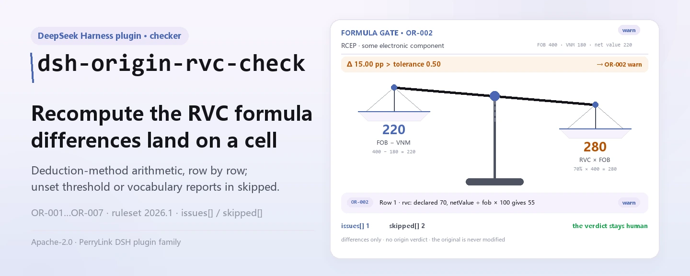

<div align="center">

<picture>
  <source media="(prefers-color-scheme: dark)" srcset="docs/assets/dsh-origin-rvc-check-hero-en-dark.webp">
  
</picture>

# dsh-origin-rvc-check

**Verifique linha a linha a aritmética do RVC e os campos declarados de um registo de determinação de origem — e receba uma lista do que é inconsistente, onde e o que corrigir.**

Um verificador de DeepSeek Harness para pessoal de certificados de origem e alfândegas: o pacote de regras nunca inventa uma citação, apenas enumera as diferenças que o próprio registo permite decidir mecanicamente, não emite juízo de conformidade nem atribui responsabilidade, e nunca altera o original.

[Instalar](#instalação-em-três-passos) · [Configuração](#configuração) · [FAQ](#faq) · [简体中文](README.md) · [English](README.en.md) · [Español](README.es.md) · [Português](README.pt.md) · [हिन्दी](README.hi.md)

[](LICENSE)
[](#compatibilidade)
[](https://www.npmjs.com/package/dsh-origin-rvc-check)
[](https://github.com/PerryLink/dsh-origin-rvc-check/actions/workflows/ci.yml)
[](#compatibilidade)

[](https://github.com/PerryLink/dsh-origin-rvc-check/stargazers)
[](https://www.npmjs.com/package/dsh-origin-rvc-check)
[](https://dshfind.com/plugins/PerryLink/dsh-origin-rvc-check?ref=badge)
[](https://securityscorecards.dev/viewer/?uri=github.com/PerryLink/dsh-origin-rvc-check)
[](https://dsh.market/)
[](https://gitee.com/perrylink/dsh-origin-rvc-check)

```sh
dsh plugin --profile <name> add dsh-origin-rvc-check
```

</div>

<sub>Plugin da comunidade, não afiliado à DeepSeek. Repositório canónico: <https://github.com/PerryLink/dsh-origin-rvc-check> (o Gitee é um espelho).</sub>

## O que é

O `dsh-origin-rvc-check` lê um registo de determinação de origem (原产地判定台账) —o cabeçalho do acordo mais uma linha por material— e verifica a aritmética desse próprio registo: que o acordo e o produto sejam declarados, que o conteúdo de valor regional seja igual a (FOB − valor dos materiais não originários) ÷ FOB × 100, que o RVC atinja o limiar que configura, que cada material indique a sua origem, que o critério de origem venha do vocabulário do seu acordo, que os números de material não se repitam e que não reste nenhum marcador de modelo por substituir na descrição. Entrega o material original (uma tabela, um registo ou um documento; o Excel pode ser convertido antes para JSON/YAML, até no chat se a plataforma o permitir) e recebe uma lista do que é inconsistente, onde e o que corrigir. Não emite juízo de conformidade nem atribui responsabilidade, não substitui o revisor e nunca altera o original.

<picture>
  <source media="(prefers-color-scheme: dark)" srcset="docs/assets/dsh-origin-rvc-check-flow-v5-dark.svg">
  
</picture>

## Instalação em três passos

1. **Instale**:

   ```sh
   dsh plugin --profile <name> add dsh-origin-rvc-check
   ```

   Também figura no pacote «Customs Compliance Suite» do WorkBuddy / Coze (esta verificação é uma das suas partes; disponibilidade conforme catálogo).

2. **Configuração mínima** (os valores por omissão já funcionam):

   ```yaml
   - insert:
       - id: dsh-origin-rvc-check
         name: dsh-origin-rvc-check
   ```

   Todos os parâmetros ficam no esquema Schemastery de `src/config.ts`; os valores por omissão funcionam de imediato. Os limites por regra ficam no pacote de regras sob `rules/`.

3. **Verifique que monta**:

   ```sh
   dsh --profile <name> --dump-config | grep 'dsh-origin-rvc-check'
   ```

   Depois execute uma vez a amostra incluída (cerca de 1 minuto):

   ```sh
   node samples/quickstart/run.mjs --check
   ```

   A entrada da amostra está em `samples/quickstart/input/`, a saída esperada em `samples/quickstart/expected/result.json` e a captura de execução em `docs/assets/quickstart.png`.

**Desinstalar**: `dsh plugin --profile <name> remove dsh-origin-rvc-check` (ou remova a linha do patch do perfil).

<details>
<summary>Instalar a partir do mercado do DSH Desktop</summary>

Todos os plugins PerryLink podem ser explorados no mercado integrado do DSH Desktop: **Market → Sources → add source → colar** `https://perrylink-dsh-catalog.perrylink.workers.dev/catalog-source.json` **→ selecionar**. A instalação continua a passar pela verificação de identidade npm do mercado e pela sua confirmação.

</details>

## Capacidades principais

O plugin registra a ferramenta `origin_rvc_check`: lê um registo de origem (cabeçalho do acordo mais uma linha por material), aplica um pacote de regras versionado e devolve um relatório estruturado.

- **O pacote de regras é dado** — as sete verificações vivem em `rules/origin-rvc-check.yaml`, pelo que trocar as regras não toca no código; o pacote é validado ao carregar, não é tomado como certo.
- **Apenas a aritmética do próprio registo** — o RVC é recalculado pela fórmula de dedução e comparado linha a linha com o valor declarado; o plugin não decide se esse RVC basta para obter origem nem se a convenção de cálculo é a correta.
- **A severidade segue a evidência** — uma regra baseada num princípio (`derived-from-principle`) fica limitada a `warn`; um limiar configurado pela instituição (`institutional-configuration`) fica limitado a `info`; nenhuma pode ser marcada `error` (há um teste que o afirma).
- **Uma lista vazia nunca é «não há problemas»** — toda a verificação que não pôde correr reporta-se em `skipped` com o motivo; uma regra cujo limiar ou vocabulário não está configurado reporta-se em `skipped` em vez de passar em silêncio.
- **Não adjudica** — o relatório apenas enumera diferenças e nunca se pronuncia sobre conformidade, responsabilidade ou correção; um guardião de redação impõe a declaração de exoneração em todos os relatórios.
- **As citações têm de ser literais** — cada regra traz documento, número, cláusula, trecho e fonte; quando o trecho tem menos de oito caracteres ou o texto exato não foi obtido, o trecho di-lo e a regra é marcada `derived-from-principle`: nunca se disfarça uma paráfrase de citação.

```text
registo de origem (acordo · produto · linhas de material) ──origin_rvc_check──▶ pacote OR-001…OR-007 ──▶ relatório (findings + skipped)
        ▲                                                                                                        │
        └────────────────────────────────────── o original nunca é alterado ───────────────────────────────────┘
```

### As regras de relance

| Regra | Verificação | Severidade | Tipo de base |
|---|---|---|---|
| `OR-001` | o acordo e o produto são declarados | warn | princípio |
| `OR-002` | o RVC segue a fórmula de dedução | warn | princípio |
| `OR-003` | o RVC atinge o limiar configurado (desativada por omissão) | info | local |
| `OR-004` | cada material indica a sua origem | warn | princípio |
| `OR-005` | o critério vem do seu vocabulário (desativada por omissão) | info | local |
| `OR-006` | os números de material não se repetem | warn | princípio |
| `OR-007` | a descrição não contém marcadores por substituir | warn | princípio |

### Exemplos

São os pontos de entrada reais do plugin; instale uma vez e chame um.

**Saída detalhada** — ferramenta `origin_rvc_check`, entrada:

```json
{"product":"某型电子元件","rows":[{"序号":"1","商品编号":"8541400000","品名":"某型电子元件","原产国":"日本","成交价格":"180","币制":"USD","非原产材料价值":"180","是否原产":"否","区域价值成分":"55.00","原产地标准":"RVC"}]}
```

Saída:

```json
{
  "id": "dsh-origin-rvc-check.OR-001.811c9dc5",
  "ruleId": "OR-001",
  "severity": "warn",
  "locator": {
    "field": "agreement"
  },
  "found": "材料表头缺少 agreement",
  "expected": "表头应提供 agreement、product"
}
```

*Observado em `dsh-origin-rvc-check/tests/fixtures/OR-001/OR-001-unsafe.json`*

### O que ele responde

| Você pergunta | O que ele responde |
|---|---|
| A coluna «区域价值成分» diz `70.00`, mas o «净价值» da linha é `220` e o FOB do cabeçalho é `400`. Isso é detetado? | Sim. O `OR-002` recalcula a fórmula de dedução (FOB − valor dos materiais não originários) ÷ FOB × 100 a partir da coluna «净价值» e do FOB, com uma tolerância de 0,5 pontos, e assinala a linha quando o RVC declarado não coincide. Faz apenas a aritmética e assume o método de dedução: um registo calculado pelo método de acumulação é assinalado embora a sua convenção esteja correta, pelo que deve alterar `expression` ou desativar a regra. Se o RVC, o «净价值» ou o FOB não forem legíveis como número, a regra reporta-se em `skipped` em vez de passar em silêncio. |
| Não há nenhum limiar configurado e todas as linhas passaram. O RVC chegou a ser verificado? | Não. O `OR-003` traz `threshold: 0`, que significa não configurado, por isso a regra aparece em `skipped` em vez de passar em silêncio. Defina `threshold` com o valor do seu acordo (por exemplo `40`) e passará a assinalar cada linha cujo RVC fique abaixo dele. Uma ocorrência significa apenas «abaixo do limiar que definiu», não que as mercadorias não sejam originárias: a origem também pode ser obtida por critérios de totalmente obtido ou de mudança de classificação pautal, e o RVC é apenas um dos caminhos. |
| Uma linha de material deixa «原产国» em branco. | O `OR-004` assinala cada linha em que a coluna «原产国» (origem) existe mas está vazia. Verifica apenas que a célula está preenchida, não se a origem declarada é verdadeira nem se afeta o estatuto de originário; quando o material não tem qualquer coluna de origem, a regra reporta que não se aplica em vez de passar em silêncio. |
| A coluna «原产地标准» tem um valor que não está na minha lista. | O `OR-005` compara cada valor com a lista `values` do pacote. Essa lista vem vazia —os nomes e abreviaturas dos critérios mudam com cada acordo e o plugin não codifica nenhum— e a regra reporta-se então em `skipped`; preencha `values` com os critérios do seu acordo (完全获得, CTC, RVC, 特定加工工序 …) e qualquer valor fora dela passa a ser assinalado. Verifica apenas se o valor consta da lista, não se as mercadorias cumprem esse critério. |
| O mesmo «料件序号» aparece em duas linhas. | O `OR-006` assinala um «料件序号» (itemNo) repetido, comparando os valores sem considerar espaços. Uma repetição conta duas vezes o valor dos materiais não originários e, por isso, corrompe o RVC — é o tipo de defeito que conduz diretamente a uma conclusão errada. Reporta a repetição e não decide qual das duas linhas está mal. |
| A coluna «品名» de uma linha ainda diz `【待填】`. | O `OR-007` assinala qualquer linha cujo «品名» (descrição) contenha um dos `terms` do pacote: 【, 】, `{{`, `}}`, XXX, xxx, 待填, 待补充, TBD, todo, 示例. Um registo copiado de um modelo parece ter inventariado materiais reais, e o RVC acaba calculado sobre uma lista de materiais que não existe. Só procura os termos listados, pelo que um marcador que ninguém incluiu passa; `terms` ajusta-se ao seu próprio modelo. |

## Configuração

Todos os parâmetros ajustáveis ficam no esquema Schemastery de `src/config.ts`, portanto mudam pelo `cordis.yml` sem editar código; os limites por regra ficam no pacote de regras sob `rules/`.

| Chave | Tipo | Padrão | Descrição |
|---|---|---|---|
| `rulesFile` | string | `rules/origin-rvc-check.yaml` | Caminho do pacote de regras, relativo à raiz do pacote; substituir o ficheiro muda a versão do conjunto de regras |
| `disabledRules` | string[] | `[]` | Ids de regras a desativar; cada uma aparece em `skipped` no relatório |
| `onlyRules` | string[] | `[]` | Executar apenas estas regras; vazio executa todas |
| `skipNotes` | string | `""` | Nota acrescentada a cada motivo de `skipped`, p. ex. uma regra local de aplicação |
| `timeoutMs` | number | `120000` | Orçamento de tempo limite cooperativo da ferramenta (milissegundos) |

Parâmetros por regra que vale a pena conhecer:

- `OR-002` `expression` / `tolerance` — a fórmula do RVC, `percent` sobre `[netValue, fob]` com uma tolerância de 0,5 pontos. Substitua-a pela forma de acumulação se o seu acordo usar esse método.
- `OR-003` `threshold` — o limiar de RVC do seu acordo, p. ex. `40`. `0` significa que a regra não corre.
- `OR-005` `values` — os critérios do seu acordo, p. ex. `[完全获得, CTC, RVC, 特定加工工序]`. Vazio significa que não há verificação.
- `OR-007` `terms` — os marcadores a procurar.

## FAQ

<details>
<summary>O registo é carregado ou alterado?</summary>

Não. O `dsh-origin-rvc-check` é um verificador local: lê o texto que entrega à sua ferramenta, não carrega nada, não faz pedidos de rede e não inclui telemetria, analítica nem relatórios em segundo plano. Não escreve nada fora do resultado da ferramenta e do armazenamento de sessão/registo do próprio host DSH; o host controla esse armazenamento e a sua retenção, e este pacote não acrescenta uma segunda cópia. O documento original nunca é alterado. Esta declaração cobre o pacote npm, não o host DSH nem outros plugins do perfil (ver `PRIVACY.md`).

</details>

<details>
<summary>Sem limiar ou vocabulário configurados, tudo passa em silêncio?</summary>

Não. O `threshold` do `OR-003` e o `values` do `OR-005` vêm vazios, e a regra que não pode correr reporta-se em `skipped` com o motivo: uma lista de diferenças vazia nunca é lida como «não há nada de errado». O `OR-002` faz o mesmo quando o RVC, o valor líquido ou o FOB não são legíveis como número. Se faltar uma coluna ao registo, a lacuna é habitualmente reportada como `skipped` ou como ocorrência de campo ausente, não é adivinhada.

</details>

<details>
<summary>Porque é que todas as ocorrências são apenas `warn` ou `info`?</summary>

Por desenho: este verificador não emite determinação legal, aduaneira ou de conformidade; enumera diferenças e lacunas para uma pessoa decidir o que fazer. Uma regra baseada num princípio fica limitada a `warn`; um limiar configurado pela instituição fica limitado a `info`; ambos estão proibidos de `error` ao carregar (há um teste que o afirma).

</details>

<details>
<summary>Uma ocorrência diz que o texto da cláusula não foi obtido: serve como prova de conformidade?</summary>

Não. O pacote segue um portão de citação: nunca inventa o texto de uma cláusula. Quando o texto exato não está disponível, a ocorrência fica em `warn`/`info` e di-lo no seu `excerpt` (ver «Normas que segue»). É uma lacuna de verificação, não uma prova de que o documento cumpre —nem de que as mercadorias têm culpa.

</details>

<details>
<summary>Posso verificar um ano inteiro de registos ou um diretório completo?</summary>

Sim. A ferramenta funciona em `native` e em `ptc`; para um diretório completo use `ptc` e o custo de esquema paga-se uma só vez. Tudo corre localmente: o tempo depende do número de linhas do registo, não da rede nem de uma chamada ao modelo.

</details>

## Normas que segue

Este pacote de regras não cita nenhuma norma pública: a verificação não obteve o texto literal das regras de origem de nenhum acordo de comércio livre, pelo que o `basis` de cada regra o diz, todas são `derived-from-principle` e nenhuma passa de `warn` ou `info`. Aquilo em que as verificações se apoiam é na aritmética do próprio registo e no limiar de RVC e no vocabulário de critérios que configurar para o acordo aplicável.

| Documento | Número | Regras que o citam |
|---|---|---|
| 各自由贸易协定原产地规则（协定文本，本次未取得） | 现行协定版本本次未核实 | OR-001, OR-002, OR-003, OR-004, OR-005, OR-006, OR-007 |

**Limite:** este plugin verifica a aritmética de um **registo de determinação de origem** (原产地判定台账) —que o acordo e o produto sejam declarados, que o conteúdo de valor regional seja igual a (FOB − valor não originário) ÷ FOB × 100, que o RVC atinja o limiar configurado, que cada material indique a sua origem, que o critério de origem venha do vocabulário do seu acordo, que os números de material não se repitam e que não reste nenhum marcador. **Não** decide se as mercadorias qualificam como originárias, se se aplica uma taxa preferencial, se uma declaração de origem é válida nem se houve elisão de origem.

> ### ⚠️ As regras de origem são texto de tratado e este pacote não finge citar nenhuma
>
> O RVC e os restantes critérios de origem —totalmente obtido, mudança de classificação pautal— são fixados **pelas regras de origem de cada acordo de comércio livre**. O RCEP, o ASEAN–China, o China–Coreia e os restantes diferem nos limiares (40 %, 30 % e outros níveis) e nos métodos de cálculo. **A verificação não obteve texto literal de nenhum acordo**, pelo que o `basis` de cada regra diz exatamente isso e fica em `warn` ou `info`.
>
> Antes de confiar numa ocorrência, vale a pena conhecer três consequências:
>
> - **O `OR-002` assume o método de dedução** — RVC = (FOB − VNM) ÷ FOB × 100. Alguns acordos permitem o método de **acumulação** (valor regional ÷ FOB × 100), que dá um número diferente para as mesmas mercadorias. Um registo calculado assim assinalará uma diferença; altere `expression` ou desative a regra. A verificação lê o FOB e o valor líquido com uma reserva de cabeçalho, pelo que um valor declarado uma só vez para todo o conjunto é encontrado na mesma.
> - **O limiar do `OR-003` vem por definir.** Os limiares variam por acordo *e* por linha pautal, pelo que o plugin não codifica nenhum. Uma ocorrência significa «abaixo do limiar que definiu», **não** «estas mercadorias não são originárias» —pois a origem também pode ser obtida por critérios de totalmente obtido ou de mudança de classificação pautal—. **O RVC é apenas um caminho.** Essa distinção importa e a nota da regra declara-a.
> - **O vocabulário de critérios do `OR-005` vem vazio**; os nomes e abreviaturas dos critérios mudam com cada acordo.

## Formato do material

A ferramenta aceita JSON ou YAML:

```yaml
agreement: RCEP
agreementVersion: 2022 年生效文本
exporter: 某某出口有限公司
product: 某型电子元件
fob: '400'
currency: USD
rows:
  - { 序号: '1', 商品编号: '8541400000', 品名: 某型电子元件, 原产国: 日本,
      非原产材料价值: '180', 净价值: '220', 区域价值成分: '55.00', 原产地标准: RVC }
```

Os nomes das colunas são comparados sem distinguir maiúsculas e ignorando espaços, underscores e hífenes; os nomes próprios do registo são preservados, pelo que uma ocorrência nomeia a coluna que leu. Um valor declarado uma vez no cabeçalho —o FOB, por exemplo— é encontrado pelas verificações aritméticas, pelo que não precisa de ser repetido em cada linha.

Os campos são opcionais na camada de leitura e validados pelo motor de verificação, pelo que uma exportação parcial gera ocorrências de campo ausente em vez de falhar.

## Origem das regras

Os dados das regras ficam em `rules/origin-rvc-check.yaml`, separados do código. Como as regras de origem são texto de tratado que a verificação não conseguiu obter, as entradas `basis` do pacote dizem-no explicitamente em vez de citar um acordo concreto. O carregador continua a exigir documento, cláusula, trecho e fonte por regra, e continua a proibir que uma verificação derivada de um princípio ou configurada localmente seja declarada `error`.

Os limites verificados e as conclusões deliberadamente **não** afirmadas estão em `rules/evidence/`.

## Compatibilidade

| Superfície | Estado |
|---|---|
| Harness | Faixa de peers `>=0.1.2-rc.1 <0.2.0 \|\| >=0.2.0-0 <0.3.0` — verificada para aceitar tanto `0.2.0-rc.2` quanto `0.2.1-rc.2`. `engines.dsh` é declarado como `>=0.2.1-0 <0.3.0` e o host aplica-o desde 0.2.1 |
| Node | `^22.19.0 \|\| >=24.0.0` |
| Plataformas | Todas (ESM puro; sem código nativo, sem rede, sem chamada ao modelo) |
| Modo de ferramenta | Funciona em `native` e `ptc`; para um diretório completo use `ptc` |

## Resolução de problemas

- **O `OR-002` assinala todas as linhas.** O registo foi calculado pelo método de acumulação. Altere `expression` ou desative a regra; não alargue a tolerância para esconder uma divergência de definição.
- **O `OR-002` reporta-se como skipped.** Ou a coluna de valor líquido está vazia (o método de acumulação deixa-a em branco) ou falta o FOB. A verificação não adivinha que convenção se aplica.
- **O `OR-003` reporta-se como skipped.** Não há limiar configurado. Os limiares variam por acordo e linha pautal, pelo que o plugin não codifica nenhum.
- **O `OR-003` assinala algo embora eu creia que as mercadorias cumprem.** O RVC é apenas um caminho para a origem. Os critérios de totalmente obtido ou de mudança de classificação pautal podem cumprir-se igualmente: confirme com o acordo aplicável antes de concluir algo.
- **O `OR-006` assinala duas vezes o mesmo material.** A numeração duplicada conta duas vezes o valor não originário e corrompe o RVC. Corrija o número.
- **O plugin instala mas a ferramenta não aparece.** Confirme que `main` resolve para `lib/index.mjs` e que `pnpm run build` o gerou; um `main` errado faz o carregador saltar a entrada em silêncio.
- **O `dsh plugin add` recusa o pacote por incompatibilidade.** A faixa de peers cobre `0.1.x` e `0.2.x`; se o seu runtime ficar fora, conceda isenção explícita: `dsh plugin --profile <name> allow-version dsh-origin-rvc-check@0.1.0 --dsh-version <runtime> --accept-risk`
- **Uma regra não correu.** Leia o array `skipped`: indica o id da regra e o motivo.
- **O `check` informa `manifest-peers` como falha.** O verificador estático compara com uma faixa de peers fixa anterior à linha 0.2. O runtime aplica a compatibilidade na instalação, pelo que a faixa declarada é a correta; é um problema conhecido do `dsh-plugin-dev`.
- **As horas parecem deslocadas.** Todos os cálculos são de hora local sobre as cadeias que fornece; não é aplicada conversão de fuso horário.

## Ecossistema e qualidade

- [Espelho do Gitee](https://gitee.com/perrylink/dsh-origin-rvc-check) (espelho sincronizado; o GitHub é o canónico)
- [Página do plugin no dshfind](https://dshfind.com/plugins/PerryLink/dsh-origin-rvc-check) (instalações e ranking)
- [Relatório do OpenSSF Scorecard](https://securityscorecards.dev/viewer/?uri=github.com/PerryLink/dsh-origin-rvc-check) (impulsionado por [.github/workflows/scorecard.yml](.github/workflows/scorecard.yml))
- [DSH Market](https://dsh.market/) (listado)
- [Base de conhecimento do ecossistema · escolha um verificador por material](https://perrylink.github.io/zh/checkers/choose/) (a família completa: 62 verificadores + plugins gerais)

## Desenvolvimento

```sh
pnpm install
pnpm run typecheck   # tsc --noEmit
pnpm test            # vitest, fixtures conforme/violador emparelhados por regra (tests/fixtures/<RULE>/)
pnpm run build       # tsdown -> lib/index.mjs + lib/index.d.mts
pnpm run check:readmes   # consistência dos README em cinco idiomas
node ../scripts/sync-shared.mjs dsh-origin-rvc-check   # atualizar src/shared a partir de ../_shared
```

O plugin é **orientado por dados**: `src/model.ts` declara a forma do registo, o kit partilhado fornece o leitor e o motor de verificação, e o pacote de regras declara cada verificação. O último comando copia o kit partilhado de `../_shared` para `src/shared/`; volte a executá-lo após cada alteração do kit partilhado.

As imagens do README são geradas programaticamente por [`scripts/gen-readme-assets.py`](scripts/gen-readme-assets.py) (Python + Pillow) e podem ser reexecutadas sem risco. Este plugin não tem UI, pelo que o hero é uma balança do RVC desenhada com Pillow (zh/en × clara/escura, quatro ficheiros) e a figura de estrutura é uma bancada de cálculo SVG desenhada à mão (versões clara e escura).

Topics: `dsh`, `dsh-plugin`, `deepseek-harness`, `deepseek`, `cordis`, `origin`, `rvc`

## Família e agradecimentos

Este projeto faz parte da família de plugins de DeepSeek Harness da [PerryLink](https://github.com/PerryLink) (todos Apache-2.0). Se te for útil, **uma estrela ajuda a próxima pessoa a encontrá-lo** — não há nada bloqueado por trás dela.

- [@PerryLink](https://github.com/PerryLink) — criador e mantenedor: a ferramenta `origin_rvc_check`, o pacote de 7 regras e o seu registo de verificação de cláusulas, e a documentação em cinco idiomas.

<details>
<summary>Expandir todos os plugins</summary>

| Plugin | Estado |
|---|---|
| **[dsh-aqua-input-check](https://github.com/PerryLink/dsh-aqua-input-check)** |  |
| **[dsh-archive-check](https://github.com/PerryLink/dsh-archive-check)** |  |
| **[dsh-auto-review](https://github.com/PerryLink/dsh-auto-review)** |  |
| **[dsh-autotier](https://github.com/PerryLink/dsh-autotier)** | 🧊 CONGELADO — ver o README do repo |
| **[dsh-bid-ca-precheck](https://github.com/PerryLink/dsh-bid-ca-precheck)** |  |
| **[dsh-bid-qual-check](https://github.com/PerryLink/dsh-bid-qual-check)** |  |
| **[dsh-cert-mcp](https://github.com/PerryLink/dsh-cert-mcp)** | 🧊 CONGELADO — ver o README do repo |
| **[dsh-checkpoint-rewind](https://github.com/PerryLink/dsh-checkpoint-rewind)** |  |
| **[dsh-click](https://github.com/PerryLink/dsh-click)** |  |
| **[dsh-composer-history](https://github.com/PerryLink/dsh-composer-history)** |  |
| **[dsh-contract-stance](https://github.com/PerryLink/dsh-contract-stance)** |  |
| **[dsh-customs-doc-check](https://github.com/PerryLink/dsh-customs-doc-check)** |  |
| **[dsh-data-quality](https://github.com/PerryLink/dsh-data-quality)** | 🧊 CONGELADO — ver o README do repo |
| **[dsh-demurrage-ledger](https://github.com/PerryLink/dsh-demurrage-ledger)** |  |
| **[dsh-doublecheck](https://github.com/PerryLink/dsh-doublecheck)** |  |
| **[dsh-drill-script-check](https://github.com/PerryLink/dsh-drill-script-check)** |  |
| **[dsh-eia-guide-check](https://github.com/PerryLink/dsh-eia-guide-check)** |  |
| **[dsh-emergency-plan](https://github.com/PerryLink/dsh-emergency-plan)** |  |
| **[dsh-essay-rubric-check](https://github.com/PerryLink/dsh-essay-rubric-check)** |  |
| **[dsh-evidence-check](https://github.com/PerryLink/dsh-evidence-check)** |  |
| **[dsh-export-ctl-check](https://github.com/PerryLink/dsh-export-ctl-check)** |  |
| **[dsh-fast](https://github.com/PerryLink/dsh-fast)** |  |
| **[dsh-fmea-table-check](https://github.com/PerryLink/dsh-fmea-table-check)** |  |
| **[dsh-forecast-penalty](https://github.com/PerryLink/dsh-forecast-penalty)** |  |
| **[dsh-fund-research](https://github.com/PerryLink/dsh-fund-research)** |  |
| **[dsh-github](https://github.com/PerryLink/dsh-github)** |  |
| **[dsh-gongwen-flow-check](https://github.com/PerryLink/dsh-gongwen-flow-check)** |  |
| **[dsh-gongwen-word-check](https://github.com/PerryLink/dsh-gongwen-word-check)** |  |
| **[dsh-guard-plan-qc](https://github.com/PerryLink/dsh-guard-plan-qc)** |  |
| **[dsh-hazchem-check](https://github.com/PerryLink/dsh-hazchem-check)** |  |
| **[dsh-hazplan-check](https://github.com/PerryLink/dsh-hazplan-check)** |  |
| **[dsh-hidden-risk-map](https://github.com/PerryLink/dsh-hidden-risk-map)** |  |
| **[dsh-hs-classify](https://github.com/PerryLink/dsh-hs-classify)** |  |
| **[dsh-icd-rule-check](https://github.com/PerryLink/dsh-icd-rule-check)** |  |
| **[dsh-industry-research](https://github.com/PerryLink/dsh-industry-research)** |  |
| **[dsh-lawcite-adapter](https://github.com/PerryLink/dsh-lawcite-adapter)** |  |
| **[dsh-laya](https://github.com/PerryLink/dsh-laya)** |  |
| **[dsh-lc-doc-check](https://github.com/PerryLink/dsh-lc-doc-check)** |  |
| **[dsh-learning-gap-check](https://github.com/PerryLink/dsh-learning-gap-check)** |  |
| **[dsh-library](https://github.com/PerryLink/dsh-library)** |  |
| **[dsh-local-ai](https://github.com/PerryLink/dsh-local-ai)** |  |
| **[dsh-lsp-actions](https://github.com/PerryLink/dsh-lsp-actions)** |  |
| **[dsh-mask](https://github.com/PerryLink/dsh-mask)** |  |
| **[dsh-mcp-panel](https://github.com/PerryLink/dsh-mcp-panel)** |  |
| **[dsh-medrec-qc](https://github.com/PerryLink/dsh-medrec-qc)** |  |
| **[dsh-memento](https://github.com/PerryLink/dsh-memento)** | 🧊 CONGELADO — ver o README do repo |
| **[dsh-nsfc-form-check](https://github.com/PerryLink/dsh-nsfc-form-check)** |  |
| **[dsh-nurse-record-check](https://github.com/PerryLink/dsh-nurse-record-check)** |  |
| **[dsh-observe](https://github.com/PerryLink/dsh-observe)** |  |
| **[dsh-origin-rvc-check](https://github.com/PerryLink/dsh-origin-rvc-check)** |  |
| **[dsh-ota-review-check](https://github.com/PerryLink/dsh-ota-review-check)** |  |
| **[dsh-output-styles](https://github.com/PerryLink/dsh-output-styles)** |  |
| **[dsh-paper-doc-adapter](https://github.com/PerryLink/dsh-paper-doc-adapter)** |  |
| **[dsh-permission-rules](https://github.com/PerryLink/dsh-permission-rules)** |  |
| **[dsh-permit-report-check](https://github.com/PerryLink/dsh-permit-report-check)** |  |
| **[dsh-pipeline-check](https://github.com/PerryLink/dsh-pipeline-check)** |  |
| **[dsh-pleading-draft](https://github.com/PerryLink/dsh-pleading-draft)** |  |
| **[dsh-plugin-doctor](https://github.com/PerryLink/dsh-plugin-doctor)** | 🚫 APOSENTADO (repo arquivado) |
| **[dsh-plugin-guide](https://github.com/PerryLink/dsh-plugin-guide)** |  |
| **[dsh-plugin-kit](https://github.com/PerryLink/dsh-plugin-kit)** | 🚫 APOSENTADO (repo arquivado) |
| **[dsh-plugin-upgrade](https://github.com/PerryLink/dsh-plugin-upgrade)** | 🚫 APOSENTADO (repo arquivado) |
| **[dsh-policy-brief-draft](https://github.com/PerryLink/dsh-policy-brief-draft)** |  |
| **[dsh-power-loss-split](https://github.com/PerryLink/dsh-power-loss-split)** |  |
| **[dsh-power-ticket-check](https://github.com/PerryLink/dsh-power-ticket-check)** |  |
| **[dsh-ppap-check](https://github.com/PerryLink/dsh-ppap-check)** |  |
| **[dsh-protest-deadline](https://github.com/PerryLink/dsh-protest-deadline)** |  |
| **[dsh-railway-window](https://github.com/PerryLink/dsh-railway-window)** |  |
| **[dsh-repair-order-qc](https://github.com/PerryLink/dsh-repair-order-qc)** |  |
| **[dsh-research-report](https://github.com/PerryLink/dsh-research-report)** |  |
| **[dsh-review-reply-check](https://github.com/PerryLink/dsh-review-reply-check)** |  |
| **[dsh-rulefile-check](https://github.com/PerryLink/dsh-rulefile-check)** |  |
| **[dsh-safety-brief-check](https://github.com/PerryLink/dsh-safety-brief-check)** |  |
| **[dsh-score](https://github.com/PerryLink/dsh-score)** | 🧊 CONGELADO — ver o README do repo |
| **[dsh-session-sync](https://github.com/PerryLink/dsh-session-sync)** |  |
| **[dsh-site-log-check](https://github.com/PerryLink/dsh-site-log-check)** |  |
| **[dsh-skill-pack-security](https://github.com/PerryLink/dsh-skill-pack-security)** |  |
| **[dsh-soe-decision-check](https://github.com/PerryLink/dsh-soe-decision-check)** |  |
| **[dsh-soilwater-check](https://github.com/PerryLink/dsh-soilwater-check)** |  |
| **[dsh-sop-sync-check](https://github.com/PerryLink/dsh-sop-sync-check)** |  |
| **[dsh-spc-gbt-adapter](https://github.com/PerryLink/dsh-spc-gbt-adapter)** |  |
| **[dsh-talk](https://github.com/PerryLink/dsh-talk)** |  |
| **[dsh-tender-extract](https://github.com/PerryLink/dsh-tender-extract)** |  |
| **[dsh-tender-matrix](https://github.com/PerryLink/dsh-tender-matrix)** |  |
| **[dsh-test-drive](https://github.com/PerryLink/dsh-test-drive)** |  |
| **[dsh-ticktick](https://github.com/PerryLink/dsh-ticktick)** | 🚫 APOSENTADO (repo arquivado) |
| **[dsh-translate](https://github.com/PerryLink/dsh-translate)** |  |
| **[dsh-warranty-calc](https://github.com/PerryLink/dsh-warranty-calc)** |  |
| **[dsh-budget](https://github.com/PerryLink/dsh-budget)** | 🧊 CONGELADO — ver o README do repo |
| **[dsh-claude-move](https://github.com/PerryLink/dsh-claude-move)** | 🧊 CONGELADO — ver o README do repo |
| **[dsh-defend](https://github.com/PerryLink/dsh-defend)** | 🧊 CONGELADO — ver o README do repo |
| **[dsh-draw](https://github.com/PerryLink/dsh-draw)** | 🧊 CONGELADO — ver o README do repo |
| **[dsh-reach](https://github.com/PerryLink/dsh-reach)** | 🧊 CONGELADO — ver o README do repo |
| **[dsh-background-agents](https://github.com/PerryLink/dsh-background-agents)** | 🚫 APOSENTADO (repo arquivado) |
| **[dsh-session-pin](https://github.com/PerryLink/dsh-session-pin)** | 🚫 APOSENTADO (repo arquivado) |
| **[dsh-team-rooms](https://github.com/PerryLink/dsh-team-rooms)** | 🚫 APOSENTADO (repo arquivado) |

</details>

## Licença

[LICENSE](LICENSE) (Apache License 2.0) © 2026 dsh-origin-rvc-check contributors

<p align="center"><sub>Apache-2.0 · Plugin da comunidade, não afiliado à DeepSeek.</sub></p>
